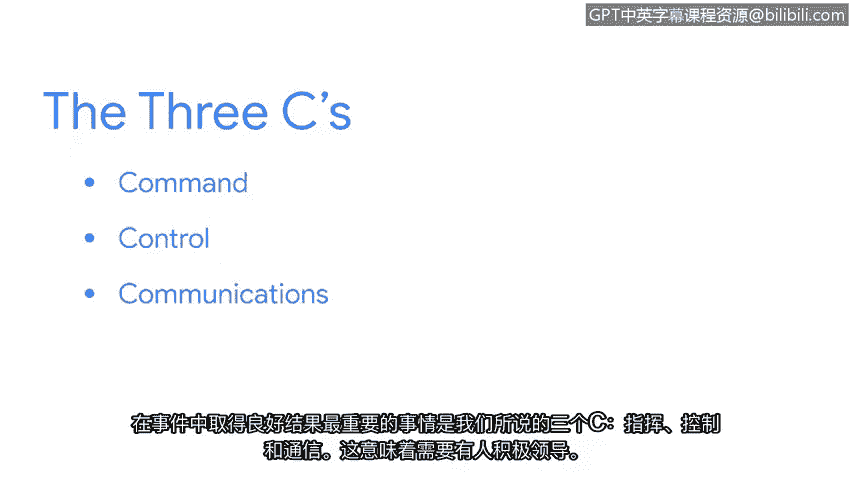

# 谷歌网络安全专业证书第三课：《连接与保护：网络与网络安全》（中英字幕，前面分p中字，后面分p英字） - P25：24_马特：处理攻击的专业人员.zh - GPT中英字幕课程资源 - BV1Zu4y1y7ht

My name's Matt， I am a chaos specialist at Google they let us choose our own job titles to best describe what it is we do。

 I spend a lot of my time planning for how to take care of anything that might possibly be going wrong and when it does happen。

 putting a team in place to fix it as quickly as possible。

I had no intention of being in technology at all。 In high school。

 I was a lifeguard first at public pools and then at a state beach。

 Lifeguarding got me into really enjoying rescue。 So I got an EM T license。

 went through firefighter school。 about half way through my college process and well into when I was being a firefighter on a daily basis。

 I was dealing with some burnout some stress。 I needed a change in my life。

 and a friend of mine who I'd been online gaming with since the early days of online gaming when it was all text based。

 He said， I can tell you're burning out hard and you need a change。

 my friends and I are going to San Francisco to start a start。 Will you come with us， And I said。

 you realize I am not a computer guy， right， And he said， no。

 you're a computer guy you just won't admit it。 The same thing that has drawn me into incident response in tech is what originally drew me to medical response。

 I really love being there for people on their worst day。😊。

Being there when people really need you and they don't know where else to turn to has always just fed this part of me。

 And that's， I'm lucky to find that same joy in DF IR， digital forensics and incident response。

What type of attacks have we faced at Google， That's a hard question to answer。

 because we face all of the kinds of attacks that most other companies face， people after ransomware。

 people after industrial secrets， other countries looking for intelligence information。

 There was a really interesting attack that occurred a little while ago。

 They were interested in getting a lot of information from technical companies specifically about vulnerabilities in software。

 and they put in place a longrun campaign to build personalities on social media as though they were legitimate security researchers。

 and then reach out to other security researchers in our field， build relationships。

 and then just at the right moment， sneak in some malware being under attack by an adversary who's made some progress is incredibly stressful。

 The first things your thinking and feeling are a little bit of a sense of panic。 Oh， no。

 this is going to be a bad day。 How long am I going to be awake working on this。 What have they done。

 What am I going to do。 And for me， the mantra that I repeat to myself is as an。Incident respondser。

 I am here to help。The things that are most important to having a good outcome in an incident are what we call the three C's command。

 control and communications， meaning someone one needs to be in charge of it， affirmatively leading。

 Someone one needs to be exerting control over everyone involved so that everyone's aligned。

 focused on the mission and the biggest and most important one of them all， proper communications。

 If you have something to offer to the incident。

Don't just go do it。 Communicate to someone。 I think I could do this to help us make progress。

 I think if we look over here， we'll find more data。

 The advice that I would give somebody who wants to get into cybersecurity is if you want it。

 you probably belong here。 The more people we have in here who are passionate。

 curiousious question askers， who want to know more who want to build better and who care about making everything more secure for the people who have to use technology。

 those are people we want in the industry and I would want you here。😊。

