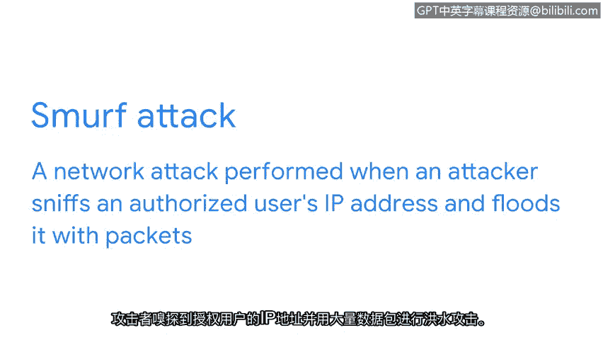

# 谷歌网络安全专业证书第三课：《连接与保护：网络与网络安全》（中英字幕，前面分p中字，后面分p英字） - P28：27_IP欺骗.zh - GPT中英字幕课程资源 - BV1Zu4y1y7ht

Next。Let's learn about another kind of network attack called Ipoofing。

 I Spoofing is a network attack performed when an attacker changes the source I of a data packet to impersonate an authorized system and gain access to a network。

In this kind of attack， the hacker is pretending to be someone they are not so they can communicate over the network with a target computer and get past firewall rules that may prevent outside traffic。

Some common I spoofing attacks are on path attacks， replay attacks and SmurF attacks。

 Let's discuss these one at a time。 An on path attack is an attack where the malicious actor places themselves in the middle of an authorized connection and intercepts or alters the data in transit。

On path attackers gain access to the network and put themselves between two devices like a web browser and a web server。

Then they sniff the packeting information to learn the I and Mac addresses of the two devices that are communicating with each other。

After they have this information， they can pretend to be either of these devices。

Another type of attack is a replay attack。 A replay attack is a network attack performed when a malicious actor intercepts a data packet and transit and delays it or repeats it at another time。

A delayed packet can cause connection issues between target computers。

Or a malicious actor may take a network transmission that was sent by an authorized user and repeated at a later time to impersonate the authorized user。

A smurf attack is a combination of a Ddos attack and an I P spoofing attack。

 The attacker sniffs an author users' I P address and floods it with packets。

 This overwhelms the target computer and can bring down a server or the entire network。

 Now that you've learned about different kinds of I P spoofing。

 Let's talk about how you can protect a network from this kind of attack。😊。

As you previously learned， encryption should always be implemented so that the data in your network transfers can't be read by malicious actors。

 Firewall can be configured to protect against I Ppoofing。

I P spoofing makes it seem like the malicious actor is an authorized user by changing the sender's address of the data packet to match the target network's address。

 So if a firewall receives a data packet from the internet where the sender's I P address is the same as the private network。

 then the firewall will deny the transmission。 Since all the devices with that I P address should already be on the local network。

 you can make sure that your firewalls configure correctly by creating a rule to reject all incoming traffic that has the same I P address as the local network。

That's it for IPpoofing。 You've learned how IP spoofing is used in some common attacks like on path attacks。

 replay attacks and SmrF attacks。

