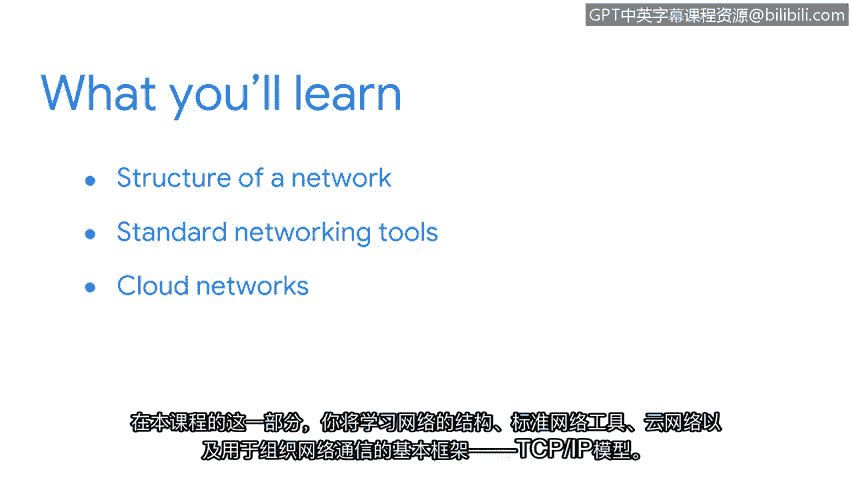

# 谷歌网络安全专业证书第三课：《连接与保护：网络与网络安全》（中英字幕，前面分p中字，后面分p英字） - P2：1_欢迎来到第一周.zh - GPT中英字幕课程资源 - BV1Zu4y1y7ht

Before securing a network， you need to understand the basic design of a network and how it functions。

In this section of the course， you will learn about the structure of a network。

 standard networking tools， cloud networks， and the basic framework for organizing communications across a network called the TCP I P model。

Securing networks is a big part of a security analyst' responsibilities。

 So I'm excited to help you understand how to secure your organization's network from threats。

 risks and vulnerabilities。 Let's get going。😊。