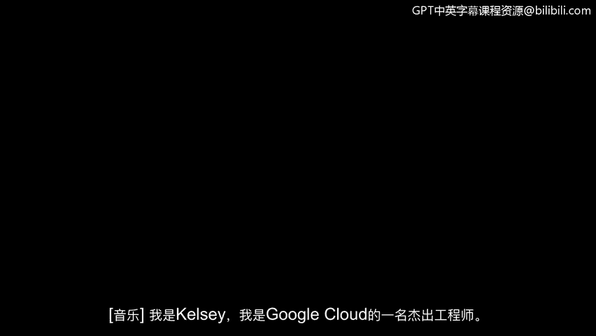
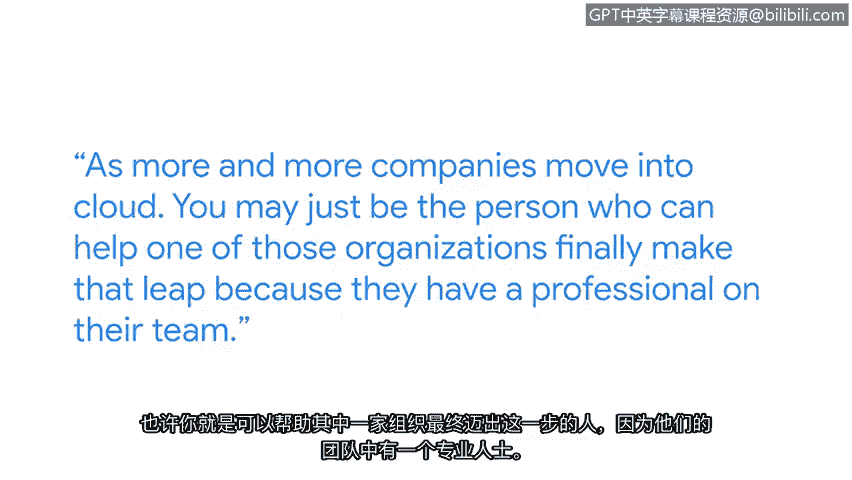

# 谷歌网络安全专业证书第三课：《连接与保护：网络与网络安全》（中英字幕，前面分p中字，后面分p英字） - P35：34_凯尔西：解释云安全.zh - GPT中英字幕课程资源 - BV1Zu4y1y7ht

I'm Kelsey， I'm a distinguishuished engineer at Google Cloud。

 I work on compute platforms and security related topics。When I was starting。

The only jobs I had previous， the only jobs I was confident were accessible to me were fast food jobs。

 I wanted a career。 I wanted more than just a job So when I zoomed out and asked myself what were my career options I couldn't think of a better place in the year 1999 than going into the world of technologies。

 I mean， on the news people were lining up for the latest operating system all the tech people were the new rock stars and I remember flipping through the opening jobs or the job openings in the classified section and it said anyone that has one of these certifications。

 let us know because we're hiring。The delta between getting started and getting your first job into that career that I always wanted。

It was $35 away in a certification book， so let's talk about cloud， so before the time of cloud。

 most companies had their own data center。 Imagine it's just you alone in your house。

You can put anything wherever you want， you may choose to never lock the doors on the inside it's just you and for a long time in our industry that's the way people ran their data centers Now we just call that private cloud。

 it's just you there， but cloud is public。And so the analogy would be imagine getting roommates。

 Now you start to think differently about your stuff。

 you start to lock things up even while you're inside of the house and your security disciplines gonna to be very different as more and more companies moving to cloud。

 you may just be the person who can help one of those organizations finally make that leap because they have a professional on their team。

 Allright， so you've gotten the certification， you've gotten the fundamental skills。

 how do you make sure that you can actually use them in the cloud。

 I'm gonna let you in a little secret， go use the cloud。

Go take existing software， throw it in a cloud， and find all the tools that poke and prod at the thing you just got running and it's going to tell you where you're weak。

 learn those tools because those are the tools that the professionals use learning is a superpower。

It gives you the ability to not only get that job that you've been looking at。

 but it also gives you the ability to define the next one。

