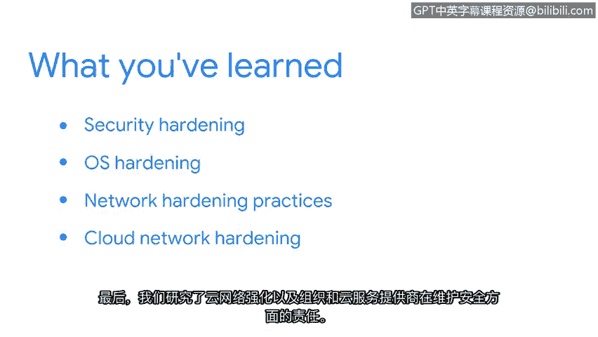

# 谷歌网络安全专业证书第三课：《连接与保护：网络与网络安全》（中英字幕，前面分p中字，后面分p英字） - P36：35_总结.zh - GPT中英字幕课程资源 - BV1Zu4y1y7ht

Great work on learning about security hardening。Let's take a few minutes to wrap up what you've learned。

You learned about security hardening and its importance to an organization's infrastructure。 First。

 we discussed how security hardening strengthens systems and networks to reduce the likelihood of an attack。

 Next， we covered the importance of O S hardening， including patch updates。

 baseline configurations and hardware and software disposal。

 Then we explored network hardening practices。 such as network log analysis and firewall rule maintenance。

 Finally， we examined cloud network hardening and the responsibilities of both organizations and cloud service providers in maintaining security。

😊。

As a security analyst， you'll be working with operating systems on premise networks and cloud networks。

 you'll be using all the knowledge that we learn in this section in your career as a security analyst。

😊。