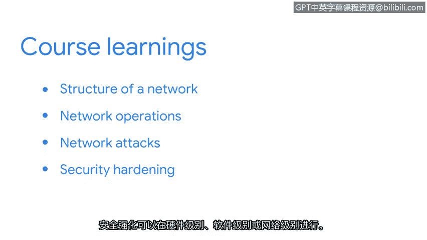

# 谷歌网络安全专业证书第三课：《连接与保护：网络与网络安全》（中英字幕，前面分p中字，后面分p英字） - P37：36_课程总结.zh - GPT中英字幕课程资源 - BV1Zu4y1y7ht

Wow， we have covered a lot in this course。Let's review everything we've discussed。

You learned about networks， network architecture， and the best practices used by security professionals to secure a network against security breaches。

As we bring this course to a close， let's review what you've learned about security networks。 so far。

 First， we explore the structure of a network。 A security analyst must understand how a network is designed to be able to identify parts of a network that present vulnerabilities and need to be secured next。

We learned about network operations and how they affect the communication of data。

 Network protocols determine how the data is transmitted over the network。

As communication takes place over the network， malicious actors may use tactics such as denial of service attacks。

 packet， sniffing and I P spoofing。Security analysts employed tools and measures such as firewall rules to protect against these attacks。

We also discussed security hardening。 Security hardening is used to reduce the attack area of a network。

 This means the attack does not disable an entire network。

 Security hardening can be done at the hardware level， the software level， or the network level。

Securing networks is an essential part of a security analyst's duties knowledgege of a network and its operations and security practices will ensure that you are successful in your career as a security analyst。

 and that brings us to the topic of our next course。

 which will cover computing basics for security analysts。In that course。

 you'll learn how to use the Linux command line to authenticate and authorize users on a network and to use SQL。

 otherwise known as SQL to communicate with databases。 Great work getting here。

All the concepts you've learned in this section will be essential for success in your role as a security analyst。

Now， you can move on to the next course， enjoy。