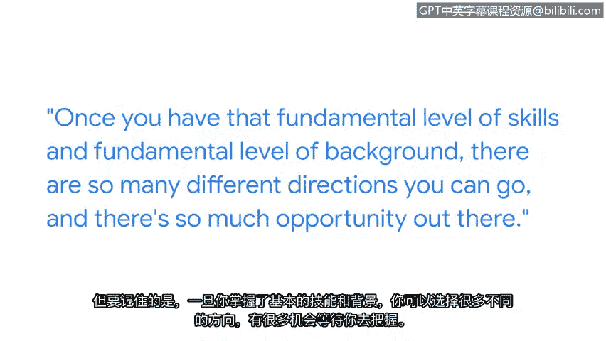

# 谷歌网络安全专业证书第三课：《连接与保护：网络与网络安全》（中英字幕，前面分p中字，后面分p英字） - P3：2_克里斯：我在网络安全领域的道路.zh - GPT中英字幕课程资源 - BV1Zu4y1y7ht

My name is Chris and I'm the chief Information security officer at Google Fiveber。

 we provide high speed internet to customers across the United States As the chief information security officer。

 I am responsible for making sure that the network stays safe。

 our customers data stays safe and that we are supporting law enforcement and others as required The career path was a long and winding one。

My actual first job was working as a butcher at the family grocery store。

 I eventually ended up with a job in the computer center at college。

 which is where I learned a lot of my initial computer skills and then when I graduated from college。

 I started off as a software developer designing accounting software for a consulting companies supporting the Department of agriculture。

 and then I moved on from that to other roles eventually ending up in one of the first internet over cable companies。

 and I ran several of their services email， web services etc。And my stuff kept getting attacked。

 I fell into cyber securitycurity because I had to defend the things that I was building。

 I realized it was fun。 I realized that it was a great career opportunity。

 And so I've just stuck with that ever since then。😊，When I got into this field。

 other than a couple of books， there wasn't a lot of training material out there。

 There were some other people out there that I could ask questions of that I could。

 could get some mentoring from。 But as a general rule of thumb I was on my own。

 Despite this being a fairly technical field， The most important thing you're going to learn are the connections you're going to make to other people。

 I made a conscious decision to become actively involved in some of the outside work organizations。

 the trade associations， the nonprofits， the meet ups and other cybersecur organizations。

 This enabled me to build the reputation and the relationships。 so that as my career moved along。

 people were reaching out to me saying， hey， Chris， we have this opportunity， Are you interested。

 Because the cybersecurity industry is so varied。 It can seem like there is a tremendous amount you have to learn that there is this huge step that you have to take。

😊，In order to get into the industry， and that can be daunting。

But the thing to remember is once you have that fundamental level of skills and fundamental level of background。

 there are so many different directions you can go， and there's so much opportunity out there。

There's this continuous education and curiosity aspect of the job that is so much fun。

 And it means that you are always having the opportunity to learn something new to。😊。

Change directions and go in new ways， because cyber securityity is going to be constantly changing。

 And that's part of the fun。