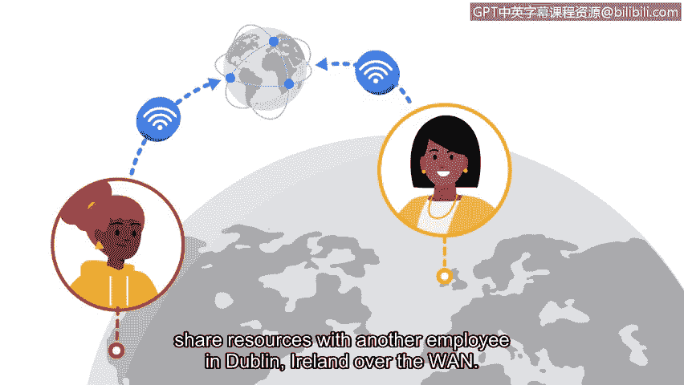

# 谷歌网络安全专业证书第三课：《连接与保护：网络与网络安全》（中英字幕，前面分p中字，后面分p英字） - P41：3_03_what-are-networks.en_subtitled - GPT中英字幕课程资源 - BV1Zu4y1y7ht

Welcome。Before you can understand the importance of securing a network。

 you need to know what a network is。A network is a group of connected devices at home。

 The devices connected to your network might be your laptop。

 cell phones and smart devices like your refrigerator or air conditioner。In an office。

 devices like workstations， printers and servers all connect to the network。

The devices on a network can communicate with each other over network cables or wireless connections。

Networks in your home and office can communicate with networks in other locations and the devices on them。

Devices need to find each other on the network to establish communications。

These devices will use unique addresses or identifiers to locate each other。

The addresses will ensure that communications happens with the right device。

These are called the I P and Mac addresses。 Deves can communicate on two types of network。

A local area network also known as a land and a wide area network， also known as a w。

A local area network or land spans a small area like an office building， a school or a home。

 For example， when a personal device like your cell phone or tablet connects to the Wi Fi in your house。

 they form a land。The land then connects to the Internet。

 A wide area network or when spans a large geographical area like a city， state or country。

 You can think of the Internet as one big win。An employee of a company in San Francisco can communicate and share resources with another employee in Dublin Ireland over the land。

Now that you've learned about the structure and types of networks。

 Meet me in an upcoming video to learn about the devices that connect to them。

