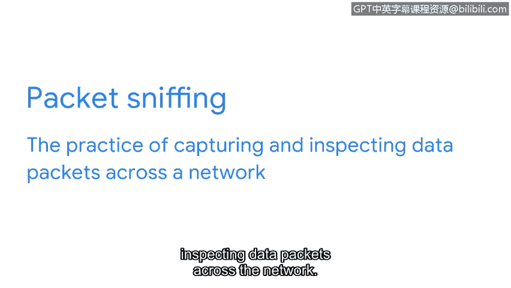

# 谷歌网络安全专业证书第三课：《连接与保护：网络与网络安全》（中英字幕，前面分p中字，后面分p英字） - P46：8_01_introduction-to-network-communication.en_subtitled - GPT中英字幕课程资源 - BV1Zu4y1y7ht

Networks help organizations communicate and connect。

 But communication makes network attacks more likely because it gives a malicious actor an opportunity to take advantage of vulnerable devices and unprotected networks。

Communication over a network happens when data is transferred from one point to another。

Pieces of data are typically referred to as data packets。

A data packet is a basic unit of information that travels from one device to another within a network。

When data is sent from one device to another across a network。

 it is sent as a packet that contains information about where the packet is going。

 where it's coming from， and the content of the message。

Think about data packets like a piece of physical mail。

 Imagine you want to send a letter to a friend。 The envelope will need to have the address where you want the letter to go and your return address。

Inside the envelope is a letter that contains the message that you want your friend to read。

A data packet is very similar to a physical letter and contains a header that includes the internet protocol address。

 the IP address， and the media access control or Mac address of the destination device。

 and also includes a protocol number that tells the receiving device what to do with the information in the packet。

Then there's the body of the packet， which contains the message that needs to be transmitted to the receiving device。

Finally， at the end of the packet， there's a footer。Similar to a signature on a letter。

 the footer signals to the receiving device that the packet is finished。

The movement of data packets across a network can provide an indication of how well the network is performing。

Network performance can be measured by bandwidth。Bandth refers to the amount of data a device receives every second。

 You can calculate bandwidth by dividing the quantity of data by the time and seconds。

Speed refers to the rate at which data packets are received or downloaded Security personnel are interested in network bandwidth and speed。

 because if either are irregular， it can be an indication of an attack。

Packet sniffing is the practice of capturing and inspecting data packets across the network。

 Communication on a network is important for sharing resources and data because it allows organizations to function effectively。

 Coming up， you'll learn more about the protocols that support network communication。

