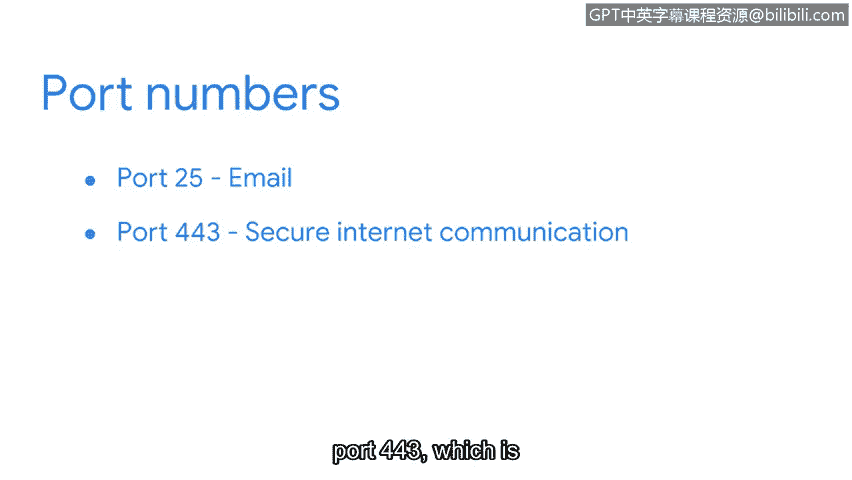
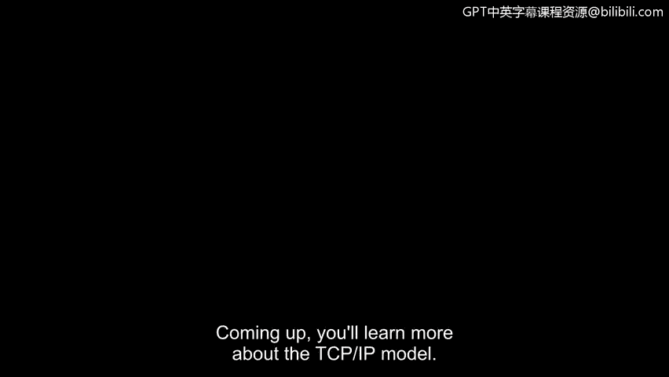

# 谷歌网络安全专业证书第三课：《连接与保护：网络与网络安全》（中英字幕，前面分p中字，后面分p英字） - P47：9_02_the-tcp-ip-model.en_subtitled - GPT中英字幕课程资源 - BV1Zu4y1y7ht

Hello again。In this video， you'll learn more about communication protocol than devices used to communicate with each other across the Internet。

 This is called the TCP I P model。 TC P I P stands for transmission control Proto and Internet Pro。

 T C P I P is the standard model used for network communication。

Let's take a closer look at this model by defining TCP and IP separately。

 First TCP or a transmission control protocol is an internet communication protocol that allows two devices to form a connection and stream data。

The protocol includes a set of instructions to organize data so it can be sent across a network。

 It also establishes a connection between two devices and make sure the packet reaches the appropriate destination。

The I in TCPIP stands for Internet Protocol IP is a set of standards used for routing and addressing data packets as they travel between devices on a network。

 included in the Internet protocol is， the IP address that functions as an address for each private network。

 you'll learn more about IP addresses a bit later。When data packets are sent and received across a network。

 they are assigned to port。Within the operating system of a network device。

 a port is a software based location that organizes the sending and receiving of data between devices on a network。

Ports divide network traffic into segments based on the service they will perform between two devices。

 The computer sending and receiving these data segments knows how to prioritize and process these segments based on their port number。

This is like sending a letter to a friend who lives in an apartment building。

 The mail delivery person not only knows how to find the building。

 but they also know exactly where to go in the building to find the apartment number where your friend lives。

 Data packets include instructions that tell the receiving device what to do with the information。

 These instructions come in the form of a port number。

Port numbers allow computers to split the network traffic and prioritize the operations。

 They will perform with the data。 Some common port numbers are port 25， which is used for email。

 port 4，4，3， which is used for secure internet communications and port 20 for large file transfers。

 As you've learned in this video， a lot of information and instructions are contained in data packets as they travel across the network。

 Coming up， you'll learn more about the TC P I P model。

