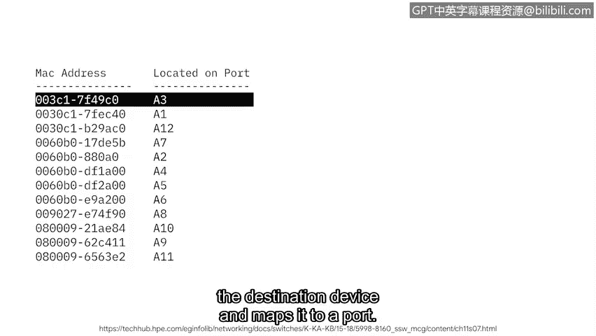

# 谷歌网络安全专业证书第三课：《连接与保护：网络与网络安全》（中英字幕，前面分p中字，后面分p英字） - P49：11_01_ip-addresses-and-network-communication.en_subtitled - GPT中英字幕课程资源 - BV1Zu4y1y7ht

Let's learn about how IP addresses are used to communicate over a network。

IP stands for Internet Procol， an Internet Procol address or IP address is a unique string of characters that identifies the location of a device on the Internet。

Each device on the Internet has a unique IP address。

 just like every house on a street has its own mailing address。There are two types of IP addresses。

 IP version 4 or IPV4， and IP version 6 or IPV6。Let's look at examples of an IPV4 address。

IPV4 addresses are written as4，1，2 or 3 digit numbers separated by a decimal point。

In the early days of the internet， IP addresses were all IPV4， but as the use of the internet grew。

 all the IPV4 addresses started to get used up， so IPV6 was developed。

IPV6 addresses are made up of 32 characters。The length of the IPV 6 address will allow for more devices to be connected to the Internet without rounding out of addresses as quickly as IV 4 IP P addresses can be either public or private。

 Your Internet service provider assigns a public I P address that is connected to your geographic location。

When network communications goes out for your device on the internet。

 they all have the same public facing address。Just like all the roommates in one home share the same mailing address。

 all the devices on a network share the same public facing I address。

Private IP addresses are only seen by other devices on the same local network。

This means that all the devices on your home network communicate with each other using unique IP addresses that the rest of the Internet can't see。

Another kind of address used in network communications is called a Mac address。

A Mac address is a unique alphanumeric identifier that is assigned to each physical device on a network when a switch receives a data packet。

 it reads the Mac address of the destination device and maps it to a port。

It then keeps this information in a Mac address table。

Think of the Mac address table like an address book that the switchitch uses to direct data packets to the appropriate device。

In this video， you learned about IP version 4 and IP version 6 addresses。

 you learned how IP and Mac addresses are used in network communication and the difference between a public and a private IP address。

