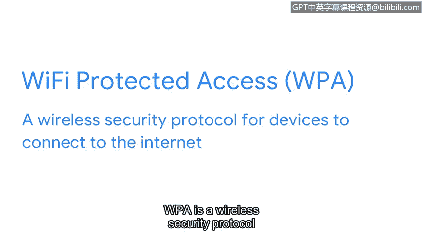

# 谷歌网络安全专业证书第三课：《连接与保护：网络与网络安全》（中英字幕，前面分p中字，后面分p英字） - P54：16_06_wireless-protocols.en_subtitled - GPT中英字幕课程资源 - BV1Zu4y1y7ht

So far you've learned about a variety of network protocols。

 including communications protocols like TCPIP。Now we're going to go more in depth into a class of communications protocols called the IAEE 802。

11。IAE 802。11， commonly known as Wi Fi， is a set of standards that define communications for wireless lenss。

IAEE stands for the Institute of Electrical and Electronics Engineers。

 which is an organization that maintains Wi Fi standards。And 802。

11 is a suite of protocols used in wireless communications。

Wi Fi protocols have adapted over the years to become more secure and reliable。

 to provide the same level of security as a wired connection。In 2004。

 a secure protocol called the Wi Fi Proected Access or WPA was introduced。

 WPA is a wireless security protocol for devices to connect to the Internet。 Since then。

 WPA has evolved into newer versions like WPA2 and WPA 3。

 which include further security improvements like more advanced encryption。

As a security analyst， you might be responsible for making sure that the wireless connections in your organization are secure。

Let's learn more about security measures。

