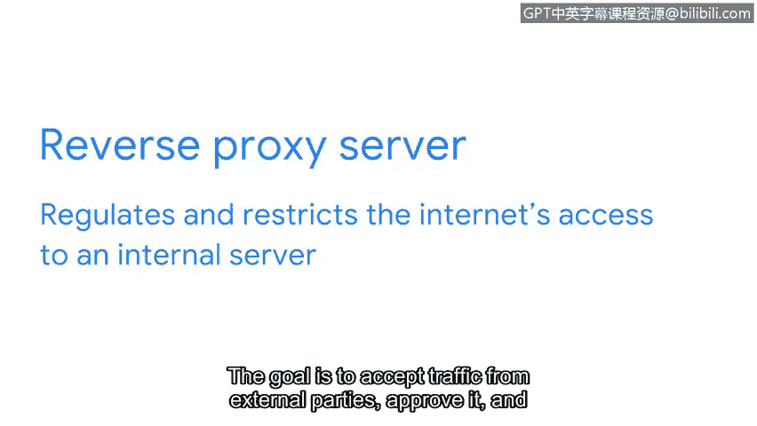

# 谷歌网络安全专业证书第三课：《连接与保护：网络与网络安全》（中英字幕，前面分p中字，后面分p英字） - P58：20_05_proxy-servers.en_subtitled - GPT中英字幕课程资源 - BV1Zu4y1y7ht

Previously， we discussed how firewalls， VPNs， and security zones help to secure networks。Next。

 we'll cover how to secure internal networks with proxy servers。

Proxy servers are another system that helps secure networks。

The definition of a proxy server is a server that fulfills the request of a client by forwarding them on to other servers。

The proxy server is a dedicated server that sits between the internet and the rest of the network。

When a request to connect to the network comes in from the Internet。

 the proxy server will determine if the connection request is safe。

 The proxy server uses a public I P address that is different from the rest of the private network。

This hides the private network's IP address from malicious actors on the internet and adds a layer of security。

Let's examine how this will work with an example when a client receives an ACTPS response。

They will notice a distorted IP address or no IP address rather than the real IP address of the organization's web server。

A proxy server can also be used to block unsafe websites that users aren't allowed to access on an organization's network。

A proxy server uses temporary memory to store data that's regularly requested by external servers。

This way， it doesn't have to fetch data from an organization's internal servers every time。

This enhances security by reducing contact with the internal server。

There are different types of proxy servers that support network security。

This is important for security analysts who monitor traffic from various proxy servers and may need to know what purpose they serve。

Let's explore some different types of proxy servers。

A forward proxy server regulates and restricts a person with access to the internet。

The goal is to hide a user's IP address and approve all outgoing requests in the context of an organization。

 a forward proxy server receives outgoing traffic from an employee， approves it。

 and then forwards it on to the destination on the internet。

A reverse proxy server regulates and restricts the internet's access to an internal server。

The goal is to accept traffic from external parties。

 approve it and forward it to the internal servers。

 This setup is useful for protecting internal web servers containing confidential data from exposing their I P address to external parties。

 An email proxy server is another valuable security tool。

 It filters spam email by verifying whether a sender's address was forged。

 This reduced the risk of phishing attacks that impersonate people known to the organization。

Let's talk about a real world example of an email proxy。 Several years ago。

 when I was working at a large US broadband ISP， we used a proxy server to implement multiple layers of anti spam filtering before the message was allowed in for delivery。

 It ended up tagging around 95% of messages of spam。

 The proxy servers would allowed us to filter and then scale those filters without impacting the underlying email platform。

Proxy servers play an important part in network security by filtering incoming and outgoing traffic and staying alert to network attacks。

 these devices add a layer of protection from unsecured public network that we call the Internet。

