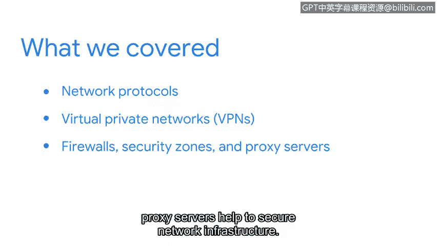

# 谷歌网络安全专业证书第三课：《连接与保护：网络与网络安全》（中英字幕，前面分p中字，后面分p英字） - P59：21_01_wrap-up.en_subtitled - GPT中英字幕课程资源 - BV1Zu4y1y7ht

You've learned a lot about some complex topics， I want to congratulate you for coming this far in the program。

Let's recap what we've covered in this section。 First， we discuss common network protocols like TCP。

 ARP， HtTPS and DNS。And then we covered how virtual private networks or VPNs can be used to maintain privacy on a public network。

 Finally， we explored how firewalls， security zones and proxy servers helped to secure network infrastructure。

Overall， network operations is a vast topic involving various tools， protocols。

 and techniques that help networks run smoothly and securely。

Feel free to come back and review these videos at any time。

 you'll use this information in any type of role as a security analyst。

