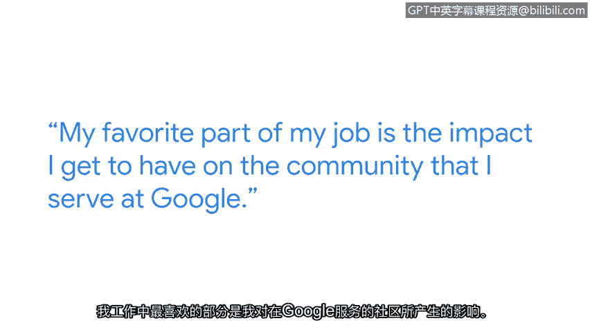

# 谷歌网络安全专业证书第三课：《连接与保护：网络与网络安全》（中英字幕，前面分p中字，后面分p英字） - P5：4_蒂娜：在网络安全领域工作.zh - GPT中英字幕课程资源 - BV1Zu4y1y7ht

My name is Tina and I'm a software engineer at Google As a software engineer I work on an internal tool that serves the security engineers and network engineers at Google network security is important because we want to make sure that our network systems are safe and resilient to be able to defend against malicious hackers and that we have the ability to protect our user data Work network security allows you to see the overview of the whole company's network systems。

 which is super cool My favorite part of my job is the impact I get to have on the community that I serve at Google I would say most of my day is a lot of coding。

 design talking to security teams and network teams on their priorities and their blockers and being able to come up with a solution There are often going to be request。

That's that come from network teams and security teams that have specific requirements on certain platforms or on a feature that they need in one of the network policies and usually we would escalate that and try to work on a fix for that。

 one piece of advice I would give for someone who wants to take on the cybersecurity journey is to be able to always keep learning and be curious about how things work because。

Security is in every changing field。 Cybersecurity is definitely a team for it。

 Everybody has something to contribute， and especially on cybersecur problems。

 there can be a lot of possibilities and a lot of different solutions to one problem。

 It's always great to be able to have people to brainstorm with and to。Track down issues together。

 because things can get。Very complex sometimes， but it's also a fun process to be able to work on things together。

