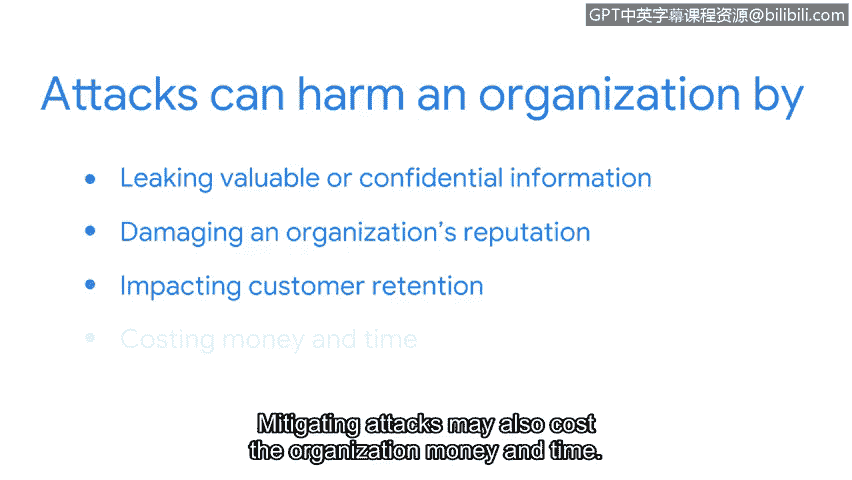

# 谷歌网络安全专业证书第三课：《连接与保护：网络与网络安全》（中英字幕，前面分p中字，后面分p英字） - P61：23_02_the-case-for-securing-networks.en_subtitled - GPT中英字幕课程资源 - BV1Zu4y1y7ht

Let's start by answering the question。Why do we need a secure networks？As you've learned。

 networks are constantly at risk of attack for malicious actors。

Attackers can infiltrate networks via malware， spoofing， or packet sniffing。

Network operations can also be disrupted by attacks such as packet flooding。As we go along。

 you're going to learn about these and other common network intrusion attacks in more detail。

 Protecting a network from these types of attacks is important。 If even one of them happens。

 it could be a catastrophic impact on an organization。

 Attacks can harm an organization by leaking valuable or confidential information。

They can also be damaging to an organization's reputation and impact customer retention。

Mitigating attacks may also cost the organization money and time。

Over the last few years， there have been a number of examples of damage that cyber attacks can cause。

 One notorious example was an attack against the American home improvementmprov chain Home Depot in 2014。

A group of hackers compromised and infected home Depot servers with malware By the time network administrators shut down the attack that hackers had already taken the credit and debit card information for over 56 million customers。

 Now， you know why it's so important to secure a network。But to keep a network secure。

 you need to know what kinds of attacks to protect it from。Coming up。

 you'll learn about some common network attacks。