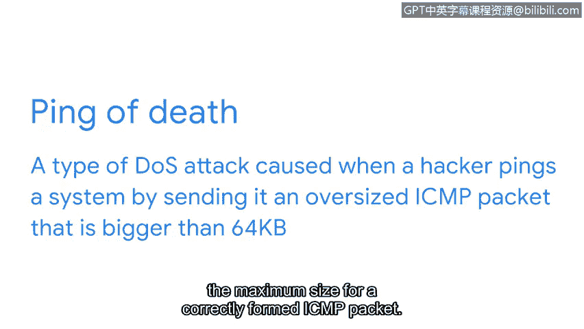

# 谷歌网络安全专业证书第三课：《连接与保护：网络与网络安全》（中英字幕，前面分p中字，后面分p英字） - P63：25_01_denial-of-service-dos-attacks.en_subtitled - GPT中英字幕课程资源 - BV1Zu4y1y7ht

Welcome back。In this video， we are going to discuss denial of service attacks。

 A denial of service attack is an attack that targets a network or server and floods it with network traffic。

 The objective of a denial of service attack or a do attack is to disrupt the normal business operations by overloading an organization's network。

The goal of the attack is to send so much information to a networked device that it crashes or is unable to respond to legitimate users。

This means that the organization won't be able to conduct their normal of business operations。

 which can cost them money and time。A network crash can also leave them vulnerable to other security threats and attacks。

A distributed denial of service attack or Ddos is a kind of dos attack that uses multiple devices or servers in different locations to flood the target network with unwanted traffic。

Use of numerous devices makes it more likely that the total amount of traffic sent will overwhelm the target server。

 remember。Dos stands for denial of service。 so it doesn't matter what part of the network the attacker overloads。

 If they overload anything， they win。An unfortunate example I've seen is an attacker who crafted a very careful packet that caused a router to spend extra time processing the request。

 The overall traffic volume didn't overload the router。 The specifics within the packet did。

Now we'll discuss network level DoOS attacks that target network bandwidth to slow traffic。

Let's learn about three common network level do attacks。 The first is called a sin flood attack。

 A sin flood attack is a type of doss attack that simulates the TC P connection and floods a server with sin packets。

So let's break this definition down a bit more by taking a closer look at the handshake process that is used to establish a TCP connection between a device and a server。

The first step in the handshake is for the device to send a sin or synchronize request to the server。

Then the server responds with a Sinac packet to acknowledge the receipt of the device's request and leaves a port open for the final step of the handshake。

Once the server receives the final a packet from the device， a TCP connection is established。

Miicious actors can take advantage of the protocol by flooding a server with S packet requests for the first part of the handshake。

But if the number of S requests is larger than the number of available ports on the server。

 then the server will be overwhelmed and become unable to function。

Let's discuss two other common DoOS attacks that use another protocol called ICMP。

ICMP stands for Internet Control Message Protocol。 ICMP is an Internet protocol used by devices to tell each other about data transmission errors across the network。

Think of ICMP like a request for a status update from a device。

The device will return error messages if there is a network concern。

You can think of this like the ICMP request checking in with the device to make sure that all is well。

An ICMP flood attack is a type of doOS attack performed by an attacker repeatedly sending ICMP packets to a network server。

This forces the server to send an ICMP packet。This eventually uses up all the bandwidth for incoming and outgoing traffic and causes the server to crash。

 Both of the attacks we've discussed so far。 Sin flood and ICMP flood take advantage of communication protocols by sending an overwhelming number of requests。

😊，There are also attacks that can overwhelm a server with one big request。

 One example that we'll discuss is called the Ping of death。

A ping of death attack is a type of dos attack that is caused when a hacker pings a system by sending in an oversized ICMP packet that is bigger than 64 k。

 The maximum size for a correctly formed ICMP packet。

 Pinging a vulnerable network server with an oversized ICMP packet will overload the system and cause it to crash。

Think of this like dropping a rock on a small anthill。

 Each individual ant can carry a certain amount of weight while transporting food to and from the anhill。

 But if a large rock is dropped on the anthill， then many ants will be crushed。

 and the colony is unable to function until it rebuilds its operations elsewhere。 Now。

 that's it for Do and Ddos attacks。 Com up will continue to discuss common network attacks。

