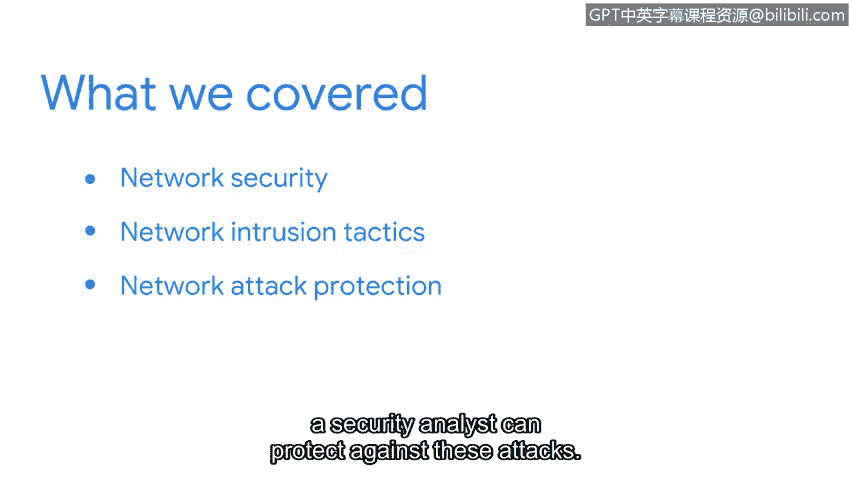

# 谷歌网络安全专业证书第三课：《连接与保护：网络与网络安全》（中英字幕，前面分p中字，后面分p英字） - P66：28_01_wrap-up.en_subtitled - GPT中英字幕课程资源 - BV1Zu4y1y7ht

Nice job finishing this section。 Let's review what you've learned so far。

 We discussed how to secure networks。 We also learned about network intrusion tactics like malicious packet sniffing and I P spoofing。

 Finally， we discussed how a security analyst can protect against these kind of attacks。😊。

You've learned about Dos and Ddos attacks like ICMP flooding， S attacks and the Ping of death。

 which try to overwhelm a network by flooding it with unwanted data packets。 Now。

 just think about everything you know already about network attacks。

What you've learned in these videos will be essential in your work as a security analyst。Coming up。

 you'll learn about how security analysts can protect a network using various security hardening techniques。

