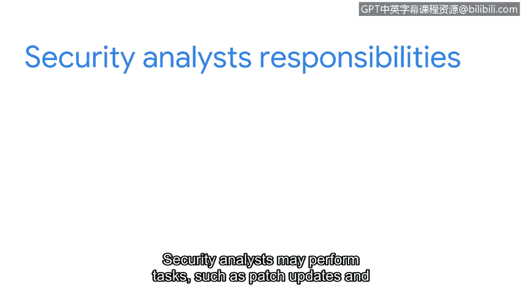

# 谷歌网络安全专业证书第三课：《连接与保护：网络与网络安全》（中英字幕，前面分p中字，后面分p英字） - P67：29_01_welcome-to-week-4.en_subtitled - GPT中英字幕课程资源 - BV1Zu4y1y7ht

I want to take a moment to congratulate you on your progress so far。 First。

 you learned about network operations。Then you learned about the tools and protocols that help network systems function。

Next， you learn how vulnerabilities and networks expose them to various security intrusions。 Now。

 we'll discuss security hardening。Then we'll learn about OS hardening。

 explore network hardening practices and discuss cloud hardening practices。

 Security hardening can be implemented in devices， networks， applications and cloud infrastructure。

Security analysts may perform tasks such as patch updates and backups as part of security hardening。

We'll discuss these tasks as you progress through the course。As a security analyst。

 Hardening will play a major role in your day to day tasks。

 which is why it's important for you to understand how it works。

I'm excited to accompany you in this journey。 Meet you in the next video。

