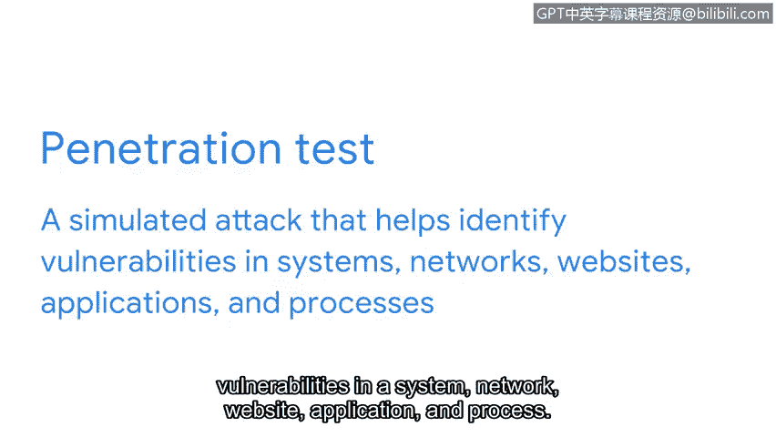

# 谷歌网络安全专业证书第三课：《连接与保护：网络与网络安全》（中英字幕，前面分p中字，后面分p英字） - P68：30_02_security-hardening.en_subtitled - GPT中英字幕课程资源 - BV1Zu4y1y7ht

Security analysts and the organizations they work with have to be proactive about protecting systems from attack。

This is where security hardening comes in。 Security hardening is the process of strengthening a system to reduce its vulnerability and attack surface。

All the potential vulnerabilities that a threat actor could exploit are referred to as a systems attack surface。

 Let's use an example that compares a network to a house。

The attack surface would be all the doors and windows that a robber could use to gain access to that house。

 Just like putting locks on all the doors and windows in a house。

 Security hardening involves minimizing the attack surface or potential vulnerabilities and keeping a network as secure as possible。

As part of security hardening， security analysts perform regular maintenance procedures to keep a network device and systems functioning securely and optimally。

Security hardening can be conducted on any device or system that can be compromised。

 such as hardware， operating systems， applications， computer networks， and databases。

Physical security is also a part of security hardening。

 This may include securing a physical space with security cameras and security guards。

 Some common types of hardening procedures include software updates。

 also called patches and device or application configuration changes。

These updates and changes are done to increase security and fixed security vulnerabilities on a network。

 An example of a security configuration change would be requiring longer passwords or more frequent password changes。

This makes it harder for a malicious actor to gain login credentials。

An example of configuration check is to updating the encryption standards for data that is stored in a database。

Keeping encryption up to date makes it harder for malicious actors to access the database。

 Other examples of security hardening include removing or disabling unused applications and services。

 Disabling unused ports and reducing access permissions across devices and network。

 minimizing the number of applications， devices， ports and access permissions。

 makes network and device monitoring more efficient and reduces the overall attack surface。

 which is one of the best ways to secure an organization。

 Another important strategy for security hardening is to conduct regular penetration testing。

A penetration test。Also called a pen test is a simulated attack that helps identify vulnerabilities in a system。

 network， website， application and process。

Penetration testers document their findings in a report。Depending on where the test fails。

 security teams can determine the type of security vulnerabilities that require fixing。

Organizations can then review these vulnerabilities and come up with a plan to fix them。Coming up。

 you'll learn more about how security hardening is an essential aspect of securing networks。

 It's a foundational part of network security that strengthens a network in order to reduce the number of successful attacks。

