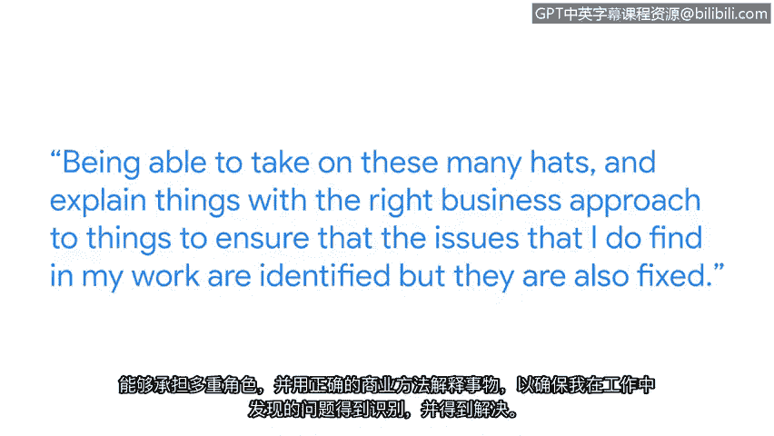

# 谷歌网络安全专业证书第三课：《连接与保护：网络与网络安全》（中英字幕，前面分p中字，后面分p英字） - P6：5_艾曼纽尔：网络安全的有用技能.zh - GPT中英字幕课程资源 - BV1Zu4y1y7ht

My name is Emmamanuel and I am an offensive security engineer at Google for offensive security。

 my job is to simulate adversaries and threats that are targeting various companies and I look at defending how we can protect Google's infrastructure I make it harder to hack Google actually hack in Google So the technical skills that I use is a lot of programming as well as learning about operational and platform security so knowing how these computers work what is under the hood and understanding the components that create this infrastructure and entry levelve cybersecurity would look at using command lines。

 log parsing and network check analysis and their everyday scope of work So command line allows you to interact with various levels of your operating system。

 whether it's the lowlevel things like the memory and the kernel or if it's highlel things like the applications and the programs that you're writing on your computer and with log parsing。

 there are going to be times where you may need to figure out and debug what is going on in in your。

Program or application and these logs are there to help you and support you in finding the root issue and then resolve it from there。

 And with this network traffic analysis， there may be times where you need to figure out why is my internet going slow。

 Why is traffic not being routed to the appropriate destination。

 What can I do to ensure that my network is up and running network traffic analysis is looking at network across various application and network layers and seeing what that traffic is doing how we can secure that traffic as well as identify any vulnerabilities and concerns in the context for me for security。

 I look at our passwords being leaked in the traffic that's being sent across the network。

 our infrastructure is being secure our firewalls being readily configured and configured safely So one skill that has continued to grow with me in my current role has been communicating effectively to product teams engineers and identifying an issue that is influencing or affecting the business and communicating。

Those teams effectively to fix it so being able to take all these many hats and explain things with the right business approach to things to ensure that the issues that I do find in my work are identified。

 but they're also fixed my advice to folks who are taking this certificate， take things apart。

 feel uncomfortable， learn and grow and find opportunities to learn and understand how things work and that skill set will benefit you for the remainder of your journey。

