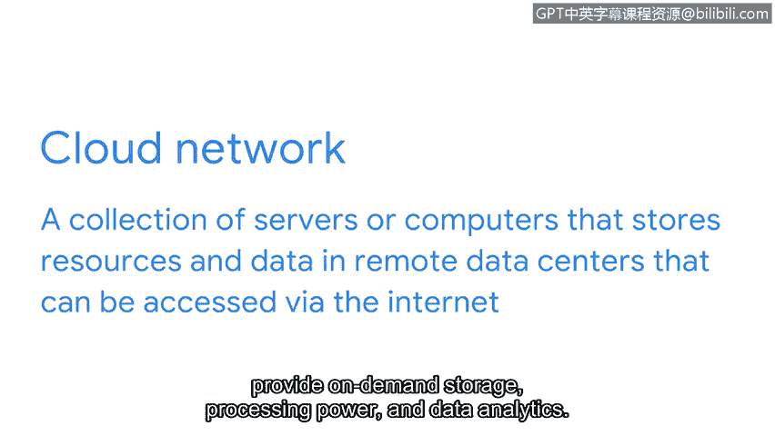

# 谷歌网络安全专业证书第三课：《连接与保护：网络与网络安全》（中英字幕，前面分p中字，后面分p英字） - P71：33_01_network-security-in-the-cloud.en_subtitled - GPT中英字幕课程资源 - BV1Zu4y1y7ht

In recent years， many organizations are using network services in the cloud。

So in addition to securing on premise networks， a security analyst will need to secure cloud networks。

In a previous video， you learned that a cloud network is a collection of servers or computers that stores resources and data in a remote data center that can be accessed via the internet。

 They can host company data and applications using cloud computing to provide on demand storage。

 processing power and data analytics。

Just like regular web servers， cloud servers also require proper maintenance done through various security hardening procedures。

 Although cloud servers are hosted by a cloud service provider。

 these providers cannot prevent intrusions in the cloud， especially intrusions from malicious actors。

 both internal and external to an organization。One distinction between cloud network hardening and traditional network hardening is the use of a server baseline image for all server instances stored in the cloud。

 This allows you to compare data in the cloud servers to the baseline image to make sure there haven't been any unverified changes。

An unverified change could come from an intrusion in the cloud network。

 similar to O S hardening data and applications on a cloud network are kept separate depending on their service category。

 For example， older applications should be kept separate from newer applications。

And software that deals with internal functions should be kept separate from front end applications seen by users。

Even though the cloud service provider has a shared responsibility with the organization using their services。

 there are still security measures that need to be taken by the organization to make sure their cloud network is safe。

Just like traditional networks， operations in the cloud need to be secured。You're doing great。

 Me you in the next video。

