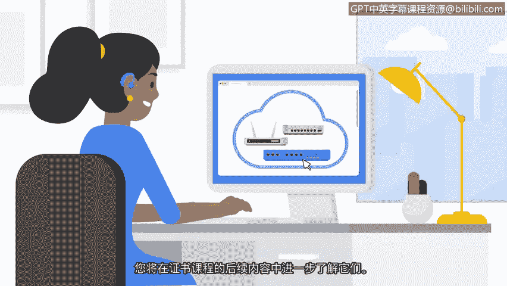

# 谷歌网络安全专业证书第三课：《连接与保护：网络与网络安全》（中英字幕，前面分p中字，后面分p英字） - P7：6_网络工具.zh - GPT中英字幕课程资源 - BV1Zu4y1y7ht

In this video， you'll learn about the common devices that make up a network。Let's get started。

A hub is a network device that broadcasts information to every device on the network。

Think of a hub like a radio tower that broadcasts a signal to any radio tuned to the correct frequency。

Another network device is a switch。A switch makes connections between specific devices on a network by sending and receiving data between them。

A switch is more intelligent than a hub。It only passes data to the intended destination。

This makes switches more secure than hubs and enables them to control the flow of traffic and improve network performance。

😊，Another device that we'll discuss is a router。A router is a network device that connects multiple networks together。

 For example， if a computer in one network wants to send information to a tablet on another network。

 then the information will be transferred as follows。 First。

 the information travels from the computer to the router。

 Then the router reads the destination address and forwards the data to the intended networks router。

 Finally， the receiving router to directs that information to the tablet。 Finally。

 let's discuss modems。 A modem is a device that connects your router to the Internet。

 and brings Internet access to the land。For example。

 if a computer from one network wants to send information to a device on a network in a different geographic location。

 it would be transferred as follows。The computer would send information to the router。

 The router would then transfer the information through the modem to the Internet。

 The Inant recipient's modem receives the information and transfers it to the router。Finally。

 the recipient's router forwards that information to the destination device。

Network tools such as hubs， switches， routers， and modems， are physical devices。However。

 many functions performed by these physical devices can be completed by virtualization tools。

Virtualization tools are pieces of software that perform network operations。

Virtualization tools carry out operations that would normally be completed by a hub， Sw。

 router or modem， and they are offered by cloud service providers。

 These tools provide opportunities for cost savings and scalability。

 You'll learn more about them later in the certificate program。 Now。

 you've explored some common devices that make up a network Com up。

 You'll going to learn more about cloud computing and how networks can be designed using cloud services。

😊。

