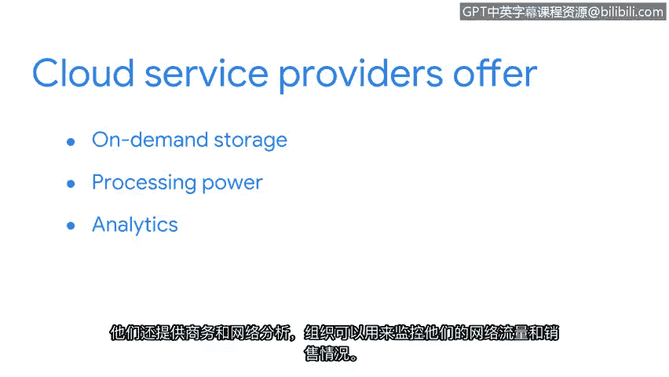

# 谷歌网络安全专业证书第三课：《连接与保护：网络与网络安全》（中英字幕，前面分p中字，后面分p英字） - P8：7_云网络.zh - GPT中英字幕课程资源 - BV1Zu4y1y7ht

Companies have traditionally owned their network devices and kept them in their own office buildings。

 but now a lot of companies are using third party providers to manage their networks。Why。

 well this model helps companies save money while giving them access to more network resources。

The growth of cloud computing is helping many companies reduce costs and streamline their network operations。

Cloud computing is the practice of using remote servers。

 applications and network services that are hosted on the Internet instead of on local physical devices。

Today， the number of businesses that use cloud computing is increasing every year。

 so it's important to understand how cloud networks function and how to secure them。

Cloud providers offer an alternative to traditional on- premisemise networks and allow organizations to have the benefit of a traditional network without storing the devices and managing the network on their own。

 A cloud network is a collection of servers or computers that stores resources and data in a remote data center and can be accessed via the internet。

Because companies don't house the servers at their physical location。

 These servers are referred to as being in the cloud。

 Traditional network hosts web servers from a business in its physical location。 However。

 cloud networks are different from traditional networks because they use remote servers。

 which allows online services and web applications to be used from any geographic location。

Cloud security will become increasingly relevant to many security professionals as more organizations migrate to cloud services。

Cloud service providers offer cloud computing to maintain applications。 For example。

 they provide on demand storage and processing power that their customers only pay as needed。

 They also provide business and web analytics that organizations can use to monitor their web traffic and sales。

With a transition to cloud networking， I have witnessed an overlap of identity based security on top of the more traditional network based solutions。

 This meant that my focus needed to be on verifying both where the traffic is coming from and the identity that is coming with it。

 More organizations moving their network services to the cloud to save money and simplify their operations。

 As this trend has grown， cloud security has become a significant aspect of network security。😊。

