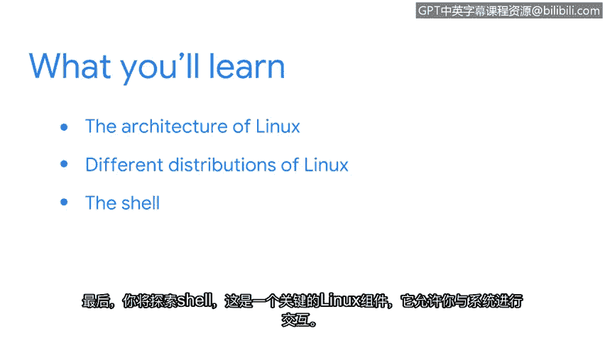

# 谷歌网络安全专业证书第四课：《工具之道：Linux与SQL》（中英字幕，前面分p中字，后面分p英字） - P10：9_欢迎来到第二周.zh - GPT中英字幕课程资源 - BV1tm4y1x74y

Welcome back。 We have another important topic to explore。 Previous。

 you learned about operating systems and user interfaces。😊。

You learned how operating systems work and how resources are allocated in computers。

We also reviewed several common operating systems。You may already have a favorite operating system。

 It's common to hear that people are fans of one over another。But in the security world。

 Linux is commonly used。In this section， you'll be learning more about the Linux operating system and how it's used in everyday tasks and security。

First， you'll learn about the architecture of Linux。 After this。

 we'll compare the different distributions of Linux that are available。 Lastly。

 you'll explore the shell， a key Linux component that allows you to communicate with the system。

I remember when I first learned about the Linux OS， and I'm really happy to explore it with you now。

