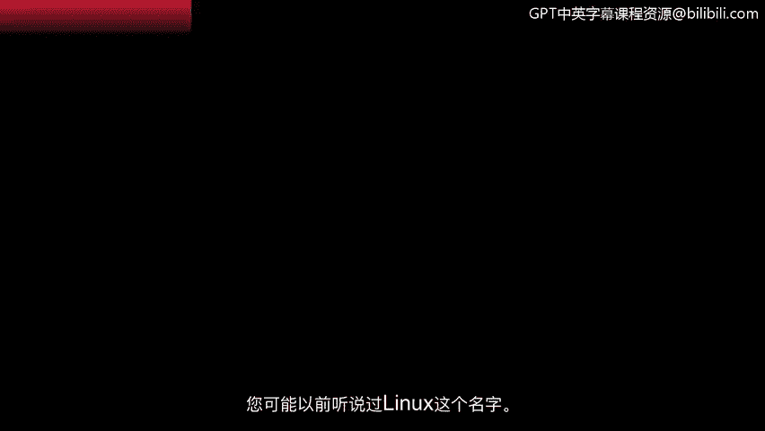

# 谷歌网络安全专业证书第四课：《工具之道：Linux与SQL》（中英字幕，前面分p中字，后面分p英字） - P11：10_Linux简介.zh - GPT中英字幕课程资源 - BV1tm4y1x74y

You might have seen or heard the name Linux in the past。

 But did you know Linux is a most used operating system in security to day。

Let's start by taking a look at Linux and how it's used in security。

 Linux is an open source operating system。It was created in two parts in the early 1990s。

 two different people were working separately on projects to improve computer engineering。

The first person was Linus Torhols。At the time， the unit's operating system was already in use。

 He wanted to improve it and make it open source and accessible to anyone。

 What was revolutionary was his introduction of the Linux kernel。

 We're going to learn what the kernelel does later。Around the same time。

 Richard Staman started working on Ganew。 Ganew was also an operating system based on Unix。

 Staman shared Provold's goal of creating software that was free and open to anyone。

After working on Goe for a few years， the missing element for this software was the kernel。Together。

 To installment innovations made what is commonly referred to as Linux。

Now that you've learned a history behind Linux， let's take a look at what makes Linux unique。

As mentioned before， Linux is open source， meaning anyone can have access to the operating system and the source code。

Linux and many of the programs that come with Linux are licensed under the terms of the Ganew public license。

 which allow you to use， share and modify them freely。 Thanks to Linux's open source philosophy。

 as well as a strong feature set。 An entire community of developers has adopted this operating system。

These developers are able to collaborate on projects and advance computing together。

As a security analyst， you'll discover that Linux is used at different organizations。

More specifically， Linux is used in many security programs。

Another unique feature about Linux is the different distributions or varieties that have been developed。

Because of the large community contribution， there are over 600 distributions of Linux Later。

 you'll learn more about distributions。Finally， let's take a look at how you would use Linux in an entry level security position。

As a security analyst， you'll use many tools and programs in everyday work。

 You might examine different types of logs to identify what's going on in a system。 For example。

 you might find yourself looking at an error log when investigating an issue。

Another place where you will use Linux is to verify access and authorization in that identity and access management system。

In security， managing access is key in order to ensure a secure system。

We'll take a closer look into access and authorization later。Finally， as an analyst。

 you might find yourself working with specific distributions designed for a particular task。

 for example， you might use a distribution that has a digital forensic tool to investigate what happened in an event alert。

You might also use a distribution that's for pen testing and offensive security to look for vulnerabilities in the system。

Distributions are created to fit the needs of their users。

 I hope you're excited to learn more about Linux。😊。

This will be a very useful skill in the security field。

