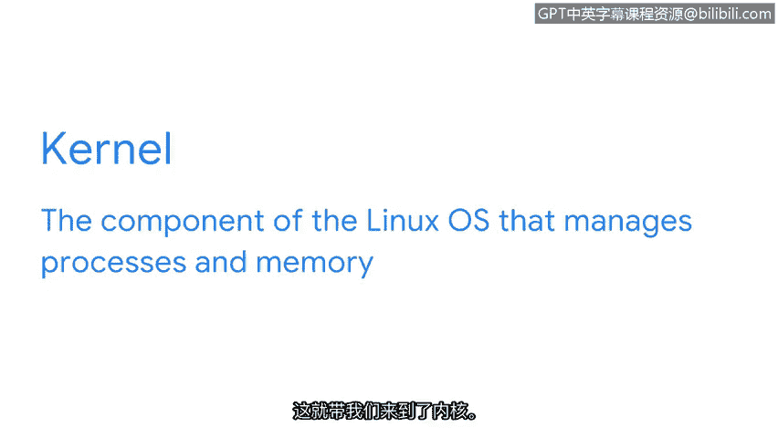

# 谷歌网络安全专业证书第四课：《工具之道：Linux与SQL》（中英字幕，前面分p中字，后面分p英字） - P13：12_Linux架构.zh - GPT中英字幕课程资源 - BV1tm4y1x74y

Let me start with a quick question that may seem unrelated to security。

 Do you have a favorite building and what is it about its architecture that impresses you the most。

 The windows， the structure of the walls。Just like buildings。

 operating systems also have an architecture and are made up of discrete components that work together to form the whole。

In this video， we're going to look at all the components that together make up Linux。

The components of Linux include the user， applications， the shell。

 the file system hierarchy standard， the kernel， and the hardware， don't worry。

 we'll go into these components one by one together first you're the user。

The user is the person interacting with a computer。In Linux。

 you're the first element to the architecture of the operating system。

You're initiating the tasks or commands that the Os is going to execute。

 Linux is a multi user system。 This means that more than one user can use the system's resources at the same time。

The second element of the architecture is the applications within a system。

An application is a program that performs a specific task， such as a word processor or a calculator。

You might hear the word application and programs used interchangeably。As an example。

 one popular Linux application that we'll learn more about later is Nano。 Naanno is a text editor。

 This simple application helps you keep notes on the screen。

 Linux applications are commonly distributed through the package managers。

 We'll learn more about this process later。The next component in the architecture of Linux is the shell。

 This is an important element because it is how you will communicate with the system。

The shell is a command line interpreter。 It processes commands and outputs the results。

 This might sound familiar。Previous， we learned about the two types of user interfaces。

 the Gui and the CI。 You can think of the shell as a CI。

 Another element of the architecture of Linux is the file system hierarchy standard。

 or FHS is the component of the Linux O S that organizes data。

An easy way for you to think about the FHS is to think about it as a filing cabinet of data。

The FHS is how data is stored in a system。It's a way to organize data so that it can be found when the data is accessed by the system。

 That brings us to the kernel。 The kernel is a component of the Linux OS that manages processes and memory。

The kernel communicates with the hardware to execute the commands sent by the shell。

 The kernel uses drivers to enable applications to execute tasks。

 The Linux kernel helps ensure that the system allocates resources more efficiently and makes the system work faster。

Finally， the last component of the architecture is the hardware hardware refers to the physical components of a computer。

 you can compare this to software applications which can be downloaded into a system。

The hardware in your computer are things like the CPU， mouse， and keyboard。Congratulations。

 we've now covered the architecture of Linux。 and understanding of these components will help you become increasingly familiar with Linux。

😊。

