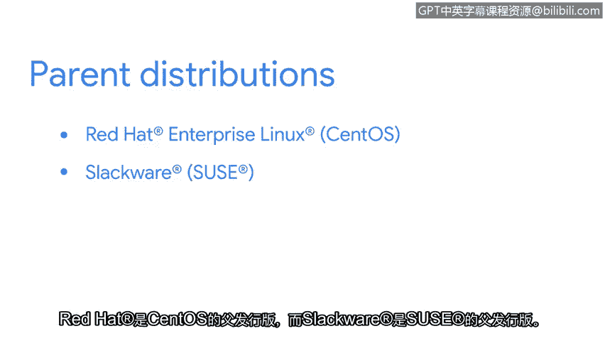

# 谷歌网络安全专业证书第四课：《工具之道：Linux与SQL》（中英字幕，前面分p中字，后面分p英字） - P14：13_Linux发行版.zh - GPT中英字幕课程资源 - BV1tm4y1x74y

Let's learn a little bit more about Linux and what you need to know about this operating system when working as a security analyst。

Linux is a very customizable operating system。 Unlike other operating systems。

 there are different versions available for you to use。

 These different versions of Linux are called distributions。

You might also hear them called distros or flavors of Linux。

 It's essential for you to understand the distribution that you're using。

 So you know what tools and apps are available to you。 For example。

 Debian is a distro that has different tools than the Abutu distribution。

 Let's use an analogy to describe Linux distributions。 Think of the O S as a vehicle。First。

 we'll start with its engine， that would be the kernel， just as the engine makes the vehicle run。

 the kernel is the most important component of the Linux OS。Because the Linux kernel is open source。

 anyone can take the kernel and modify it to build a new distribution。

 This is comparable to a vehicle manufacturer taking an engine and creating different types of vehicles。

 trucks， cars， vans， convertibles， buses， airplanes and so on。

 These different types of vehicles can be compared to different Linux distributions。

A bus is used to transport lots of people a truck is used to transport a large number of goods across vast distances。

 and aircraft transported passengers or goods by air。Just as each vehicle serves its own purpose。

 different distributions are used for different reasons。Additionally。

 vehicles all have different components which distinguish them from each other。

Aircrafts have control panels with buttons and knobs。 regularular cars have four tires。

 but trucks can have more。 Similarlyly， different Linux distributions contain different preinstalled programs。

 user interfaces and much more。A lot of this is based on what the Linux user needs。

 but some distros are also chosen based on preference the same way a sports car might be chosen as a vehicle。

The advantage of using Linux as an OS is that you can customize it。

Distributions include the Linux kernel， utilities， a package management system， and an installer。

We learned earlier that Linux is open source and anyone can contribute to adding to the source code。

That is how new distributions are created。 All distros are derived from another distro。

 but there are a few that are considered parent distributions。 Red Ha is apparent of centaus。

 and Slaware is the parent of Suusa。 Both Ubantu and Cali Linuxnox are derived from Debian。

As we continue， we're going to take a look at some of the distributions most commonly used by security analysts。

The more you understand these distributions， the easier your work will be。

