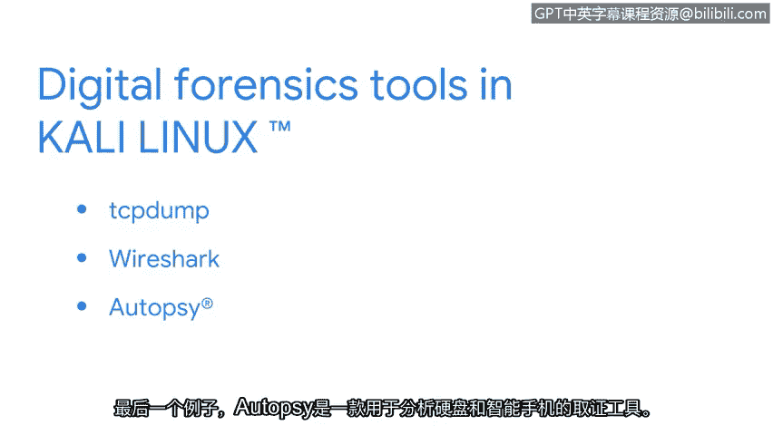

# 谷歌网络安全专业证书第四课：《工具之道：Linux与SQL》（中英字幕，前面分p中字，后面分p英字） - P15：14_Kali Linux™.zh - GPT中英字幕课程资源 - BV1tm4y1x74y

In this section， we're going to cover a Linux distribution that's widely used in security and discuss Cali Linux。

 Callli Linux is a trademark of offensive security， and is deian derived。

This open source distro was made specifically with penetration testing and digital forensics in mind。

There are many tools prein into CaI Linux。 It's important to note that Cali Linux should be used on a virtual machine。

 This prevents damage to your system in the event its tools are used improperly。

An additional benefit is that using a virtual machine gives you the ability to revert to a previous state as security professionals advance in their careers。

 some specialize in penetration testing。 A penetration test is a simulated attack that helps identify vulnerabilities and systems。

 networks， websites， applications and processes。😊，Caly Linux has numerous tools that are useful during penetration testing。

Let's look at it a few examples To begin， Melo can be used to look for and exploit vulnerabilities on machines。

 Bp suiteite is another tool that helps to test for weaknesses in web applications。 And finally。

 John the Ripper is a tool used to guess passwords。😊，As a security analyst。

 your work might involve digital forensics。 Digital forensics is a practice of collecting and analyzing data to determine what has happened after an attack。

 For example， you might take an investigative look at data related to a network activity。

Ky Linux is also a useful distribution for security professionals who are involved in digital forensic work。

 It has a large number of tools that can be used for this。 As one example。

 TCP D is a command line packet analyzer。 is used to capture network traffic。

 Another tool commonly used in the security profession is wireshark。

 It has a graphical user interface that can be used to analyze live and capture network traffic。

 And as a final example， autopsy is a forensic tool use say analyze hard drives and smarts。😊。

These are just a few tools included with Callli Linux。

This distribution has many tools used to conduct pen testing and digital forensics。

We've explored how Ca Linux is an important distribution that's widely used in security。

 But there are other distributions that security professionals use as well。 Next。

 we'll explore a few more distributions。