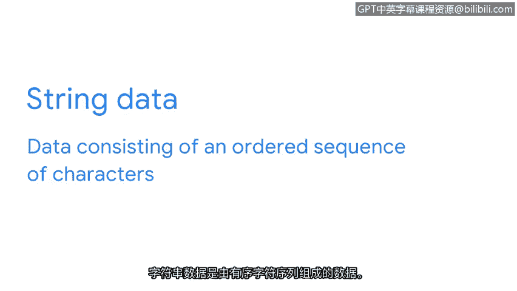
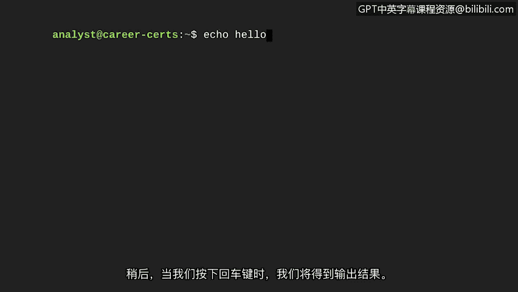
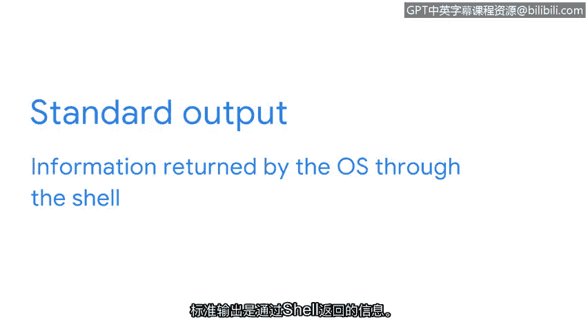
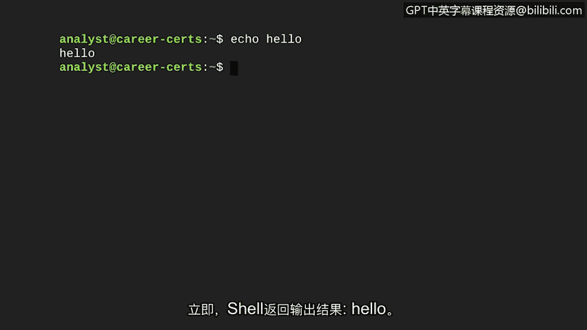
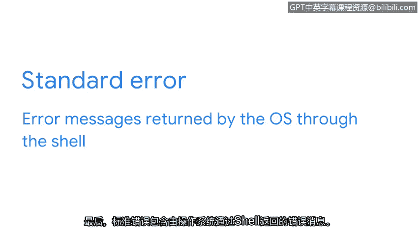
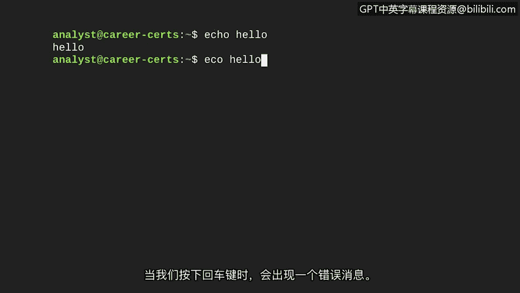

# 谷歌网络安全专业证书第四课：《工具之道：Linux与SQL》（中英字幕，前面分p中字，后面分p英字） - P17：16_Shell中的输入和输出.zh - GPT中英字幕课程资源 - BV1tm4y1x74y

Hello again。 In this video， we're going to learn a little more about the shell and how to communicate with it。

 Communicating with a computer is like having a conversation with your friend。

 One person asks a question， and the other person answers with a response。😊。

If you don't know the answer， you can just say you don't know the answer。

When you communicate with the shell， the commands in the shell can take input。

 give output or give error messages。 Let's explore standard input。

 standard output and the error messages in more detail。

 Standard input consists of information received by the Os via the command line。

This is like you asking your friend a question during a conversation。

 The information is input from your keyboard to the shell。If the shell can interpret your request。

 it asks a kernel for the resources it needs to execute the related task。

 Let's take a look at this to echo a Linux command that outputs a specified string of text。

 String data is data consisting of an order sequence of characters。

In our example， we'll just have it output the string of hellello。So as input。

 we'll type Echohelello into the shell。Later， when we press enter， we'll get the output。

 But before we do that， let's first discuss the concept of output in more detail。

 Standard output is the information returned by the O through the shell。

In the same way that your friend gives an answer to your question。

 output is a computer's response to the command you input。Output is what you receive。

Let's pick up where we left off in our example and send the input of EchoHello to the OS by pressing enterter。

Immediately， the shell returns the output of Hello。 Finally。

 standard error contains error messages returned by the O through the shell。

 just like your friend might indicate that they can't answer a question。

 the system responds with an error message if they can't respond to your command。

Sometimes this might occur when we missfell a command or the system doesn't know the response to the command。

 Other times， it might happen because we don't have the appropriate permissions to perform a command。

We'll explore another example that demonstrates standard error。

 let's input echochoHello into the shell。Notice I intentionally misspelled Echo as ECCO。

 When we press enter， an error message appears。

To wrap up， we've covered the basics of communication with the shell。

 Communication with the shell can only go in one in three ways。The system receives a command。

 This is input。The system responds to the command， and produces output。And finally。

 the system doesn't know how to respond， resulting in an error Later。

 you'll become much more familiar with this as we explore commands useful for security professionals。

