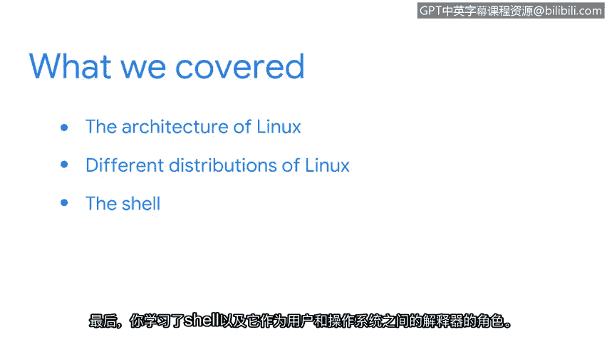

# 谷歌网络安全专业证书第四课：《工具之道：Linux与SQL》（中英字幕，前面分p中字，后面分p英字） - P18：17_总结.zh - GPT中英字幕课程资源 - BV1tm4y1x74y

We've made it to the end of this section。 Great work。 Let's recap what you've just completed。

 In this section， you learned about the Linux operating system。

 We examine the architecture of Linux in our exploration of the different distributions of Linux。

 We discuss some of the most widely used distros in security。😊，You were introduced to Cai Linux。

 thebuuntu， Parrot， Red Ha and Saus distributions。 Finally。

 you learned about the shell and its role as an interpreter between the user and operating system。😊。

Congratulations。You're doing great。 And we have more useful topics to come In the next part of the program。

 you'll learn specific commands to use within the shell while working as a security analyst。

 Let's continue on。😊。

