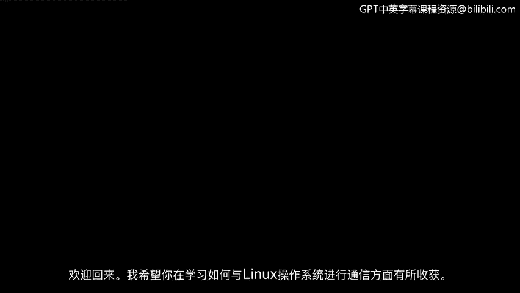
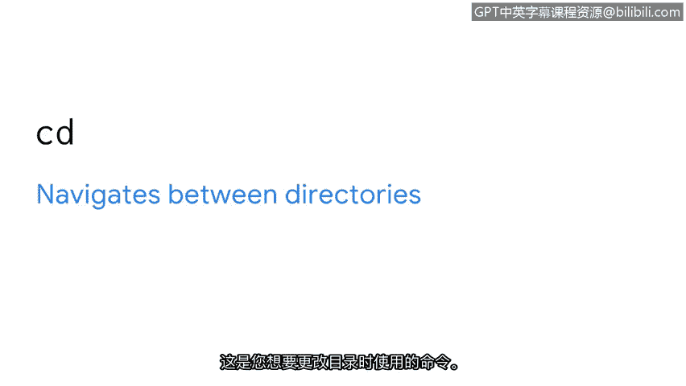
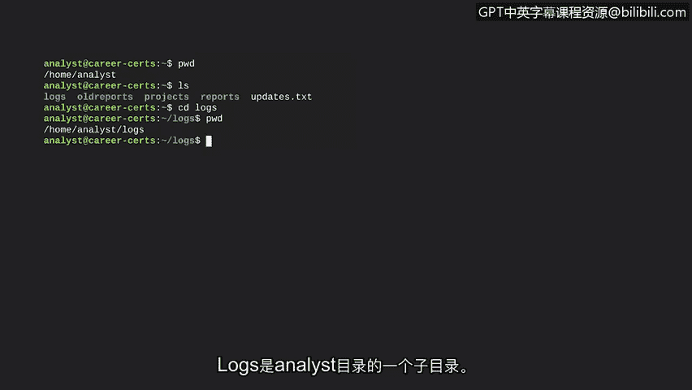
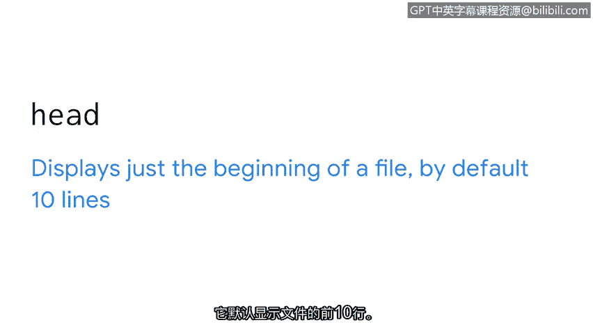
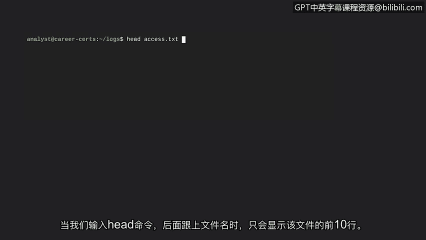

# 谷歌网络安全专业证书第四课：《工具之道：Linux与SQL》（中英字幕，前面分p中字，后面分p英字） - P21：20_导航和读取文件的核心命令.zh - GPT中英字幕课程资源 - BV1tm4y1x74y

Welcome back。I hope you're learning a lot about how to communicate with the Linux OS。

As we continue our journey into utilizing the Linux command line。

 we'll focus on how to navigate the Linux file system Now I want you to imagine a tree。

What did you notice first about the tree？Would you say the trunk or the branches。

These might definitely get your attention， but what about its roots？

Everything about a tree starts in the roots。Something similar happens when we think about the Linux file system。

Previously， we learned about the components of the Linux architecture。

 the file system hierarchy standard or FHS is a component of the Linux OS that organizes data。

This file system is a very important part of Linux because everything we do in Linux is considered a file somewhere in the systems directory。

 The FHS is a hierarchical system。 and just like with a tree。

 everything grows and branches out from the root。 The root directory is the highest level directory in Linux。

 is designated by a single slash。Sub directories branch off from the route directory。

 The subdirecties branch out further and further away from the route directory。

 when describing the directory structure and Linux。

 slashes are used when tracing back through these branches to the root。 For example， here。

 the first slash indicates the route directory。Then it branches out a level into the home subdirecty。

Another slash indicates it is branching out again。This time it's to the Anna subdirecty that is located within home。

When working in security， it is essential that you learn to navigate a file system to locate and analyze logs。

 such as log files。You'll analyze these log files for application usage and authentication。

With that background， we're now ready to learn the commands commonly used for navigating the file system。

First， P W D print the working directory onto the screen。 When you use this command。

 the output tells you which directory you're currently in。Next。

 LS displays the names of files and directories in the current working directory。And finally。

 CD navigates between directories。This is the command you'll use when you want to change directories。

Let's use these commands in bash。First， we'll type the command PWD to display the current location and then press enterter。

The output is the path to the analyst directory， where we're currently working。Next。

 let's input LS to display the files and directories within the analyst directory The output is the name of four directories。

 logs， old reports， projects and reports， and one file name updates TxT。

So let's say we now want to go into the logs directory to check for unauthorized access。

 We'll input C logs to change directories。 We won't get any output on the screen from the C D command。

 But if we enter Pw D again， its output indicates the working directory is logs。

 logs is a subdirecty of the analyst directory。 As a security analyst。

 you'll also need to know how to read file content in Linux。 For example。

 you may need to read files that contain configuration settings to identify potential vulnerabilities。

 Or you might look at user access reports while investigating unauthorized access。

When reading file content， there are some commands that will help you First。

 CAt displays the content of a file。This is useful。

 but sometimes you won't want the full contents of a large file。In these cases。

 you can use the head command。It displays just the beginning of a file by default 10 lines。

 Let's try out these commands。 Imagine that we want to read the contents of access do TxT and we're already in the working directory where it's located。

 First， we input the cat command and then follow it with the name of the file access TXT。

And Bsh returns the full contents of this file。 Let's compare that to the head command。

 When we input the head command followed by our file name。

 Only the first 10 lines of this file are displayed。

Wow， this section had lots of action and it just the beginning。

 I'm glad you learned how security analysts can use essential commands to navigate the system。 Next。

 we'll explore how to manage the system。😊。

