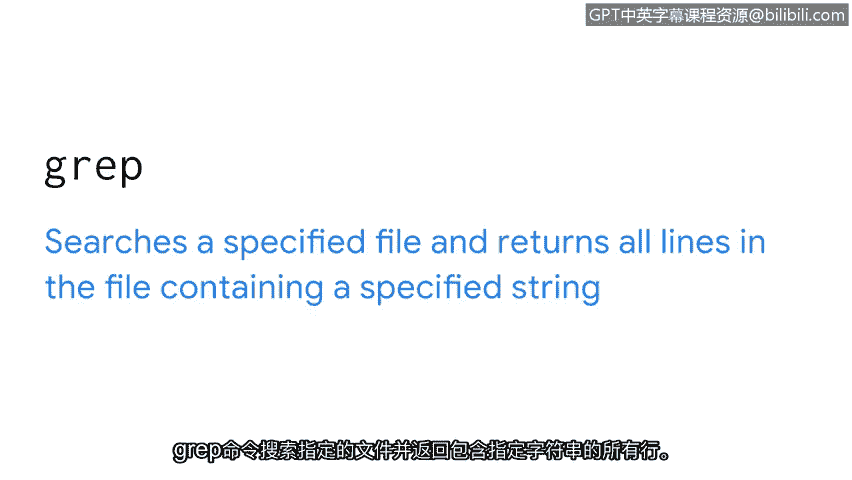
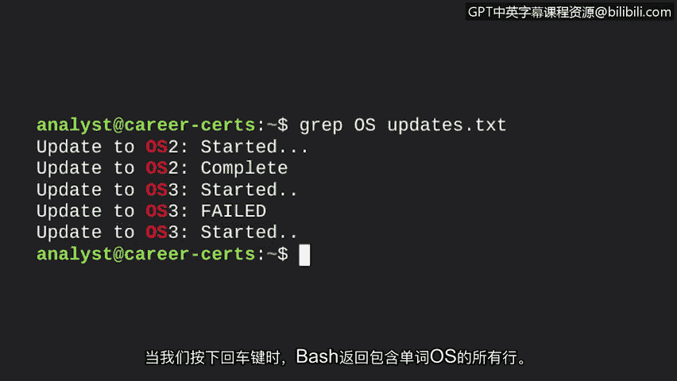
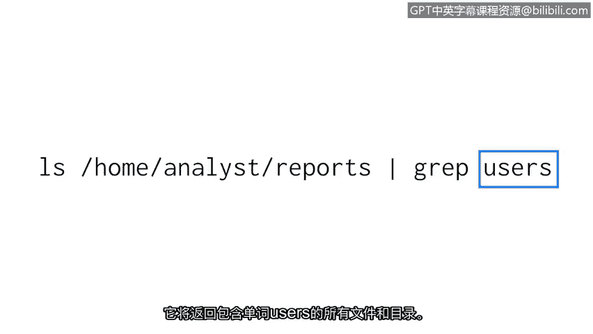
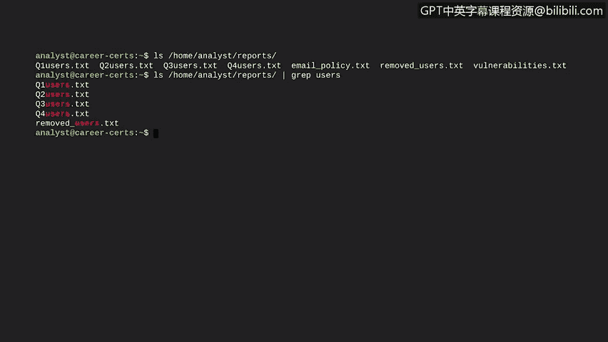

# 谷歌网络安全专业证书第四课：《工具之道：Linux与SQL》（中英字幕，前面分p中字，后面分p英字） - P22：21_使用Linux找到所需内容.zh - GPT中英字幕课程资源 - BV1tm4y1x74y

Now that we covered PWD， LS and C D， and are familiar with these basic commands for navigating the Linux file system。

 let's look at a couple of ways to find what you need within this system。As a security analyst。

 your work will likely involve filtering for the information you need。

 Ftering means searching your system for specific information that can help you solve complex problems。

For example， imagine that your team determines a piece of malware contains a string of characters。

 You might be tasked with finding other files with the same string to determine if those files contain the same malware。

 Later， we'll learn more about how you can use SQL to filter database。

 But Linux is a good place to start basic filtering。First， we'll start with GrP。

The GP command searches a specified file and returns all lines in the file containing a specified string。

Here's an example of this。 Let's say we have a file called Up do TX T。

 And we're currently looking for lines that contain the word O S。If the file is large。

 it would take a long time to visually scan for this。 Instead。

 after navigating to the directory that contains updates T X T。

 we'll type the command Grp O S updates dot T X T into the shell。

 Notice how the repep command is followed by two arguments。

 The first argument is a string we're searching for。 In this case， O S。

The second argument is the name of the file we're searching through， updates。txt。

When we press enterter， Bsh returns all lines containing the word OS。

Now let's talk about piping。Pyiping is a Linux command that can be used for a variety of purposes。

In a moment， we'll focus on how it can be used for filtering。But first。

 let's talk about the general idea of piping。The piping command sends a standard output of one command as standard input into another command for further processing。

 Its represented by the vertical bar character。 In our context。

 we can refer to this as the pipe character。 Take a moment and imagine a physical pipe。

 Phs pipes have two ends。 On one end， for example， Water might enter the pipe from a hot water tank。

 Then it travels through the pipe and comes out on the other end in a sink。Similarly， in Linux。

 piping also involves redirection。Output from one command is sent through the pipe and then is used on the other side of the pipe。

 Earl in this video， I explained how Grep can be used to filter for strings of characters within a file。

Gret can also be incorporated after a pipe Let's focus on this example。

 the first command LS instructs a operating system to output the file and directory contents of their report subdirecty。

But because the command is followed by the pipe， the output isn't returned to the screen。 Instead。

 it's sent to the next command。As we just learned， Grab searches for a specified string of characters。

In this case， it's users。But where is it searching， since Gp follows a pipe。

 the output of the previous command indicates where to search。 In this case。

 that output is a list of files and directories within the reports subdirecty。

 It will return all files and directories that contain the word users。

Okay， let's explore this in bash。 so we can better understand how the filter works。

 Let's first output everything in the reports directory。 If we were already in the directory。

 we would just need to input Ls。 But since we're not。

 we'll also specify the path to this directory When we press enter the output indicates there are seven files in the reports directory。

 because we want to return only the files that contain the word users。

 we'll combine this Ls command with piping and the Grb command。As the output demonstrates。

 Linux has been instructed to return only files that contain the wordus。

The two files that don't contain this string no longer appear。

So now you have two different ways that you can filter in Linux while working as an analyst。

Navigating through files and filtering are just part of what you need to know。

 Let's keep exploring the Linux command line。

