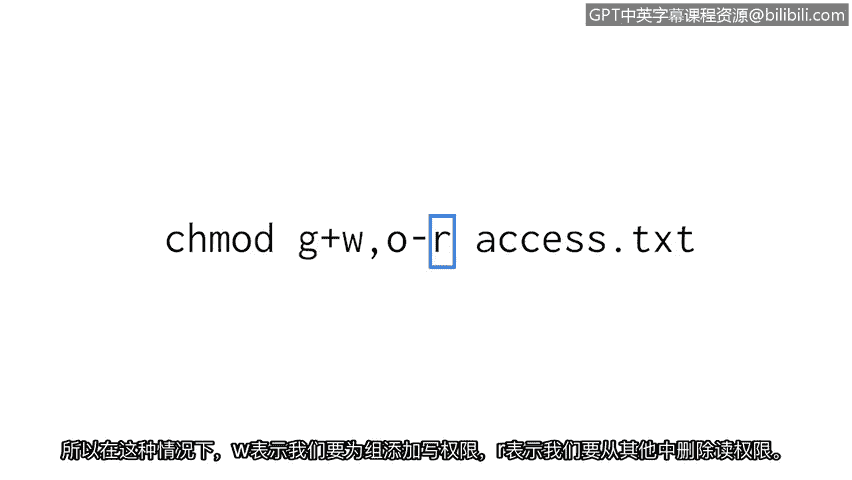
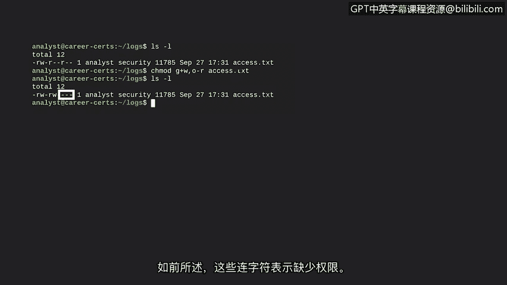

# 谷歌网络安全专业证书第四课：《工具之道：Linux与SQL》（中英字幕，前面分p中字，后面分p英字） - P25：24_更改权限.zh - GPT中英字幕课程资源 - BV1tm4y1x74y

Hi there In the previous video you learn how to check permissions for a user。In this video。

 we're going to learn about changing permissions。When working as a security analyst。

 there may be many reasons to change permissions for a user。

A user may have changed departments or been assigned to a different work group。

 a user might simply no longer be working on a project that requires CEM permissions。

These changes are necessary in order to protect system files from being accidentally or deliberately altered or deleted。

 let's explore a related command that helps control this access。In this video。

 we'll learn about CH modD。CHMoD changes permissions on files and directories。

The command CH modD stands for Change mode。There are two modes for changing permissions but we'll focus on symbolic the best way to learn about how CH modD works is through an example。

I know this has a lot of details， but break this down。Also。

 please keep in mind that like many Linux commands。

 you don't have to memorize the information and can always find a reference。With CH modD。

 you need to identify which file or directory you want to adjust permissions for。

This is the final argument， in this case a file named Access。txt。

The first argument added directly after the CHOD command indicates how to change permissions right now。

 this might seem hard to interpret， but soon we'll understand why this is called symbolic mode。

Previously， we learned about the three types of owners， user， group， and other。

To identify these with CH mod， we use U to represent the user G to represent the group。

 and O to represent other。In this particular example。

 G indicates we will make some changes to group permissions and O to permissions for other。

These owner types are separated by a comma in this argument。

 but do we want to add or take away permissions？Well， for this， we use mathematical operators。

So the plus sign after G means we want to add permissions for group。

 and the minus sign after O means we want to take them away from other。And the last question is。

 what kind of changes？We've already learned that R represents Read permissions。

 W represents write permissions， and X represents execute permissions。So in this case。

 the W indicates that we are adding right permissions to the group。

And R indicates that we are taking away re permissionmissions from other。

This is still very complex， but now that we've broken it down。

 perhaps it doesn't seem quite so much like a foreign language and remember。

 you don't have to memorize this all。Let's give this new command a try We'll start out in the log subdirecty if we use the LS L command。

 it will output the permissions for the file It shows the permissions for the only file in this directory Access TxT previously we learned how to read these permissions The second through fourth characters indicate that the user has read and write permissions The fifth through7 characters show the group only has read permissions。

And the8 through10th characters show that other only has repermissions。

We need to adjust these permissions， we want to ensure analysts in the security group have right permission。

 but take away re permissionmissions from the owner type other。

So we add write permissions for group and remove re permissionmissions for other。Let's run L， S。

 dash L， again。This shows a change in the permissions for Access。TxT。

Notice how in the middle segment of permissions for the group W has been added to give right permissions。

And another change is that the R has been removed in the last segment。

 indicating that read permissions for other have been removed。As mentioned earlier。

 these hyphens indicate a lack of permissions。

Now other is lacking all permissions。Though it requires practice。

 working in Linux becomes more natural with time， I'm glad you're learning a little more about how to use Linux。

