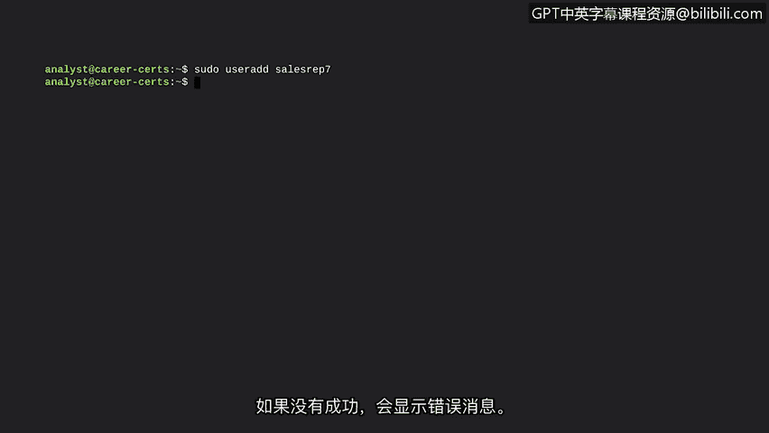
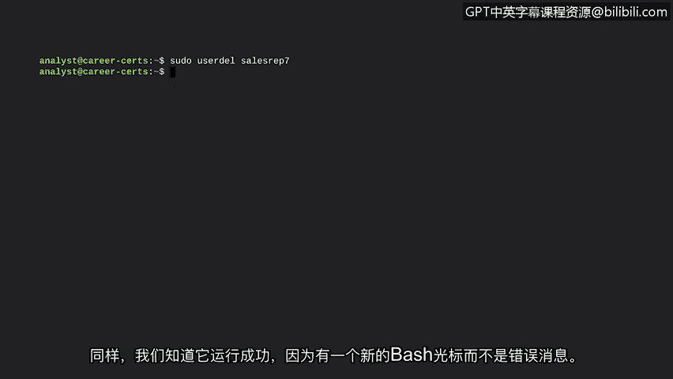

# 谷歌网络安全专业证书第四课：《工具之道：Linux与SQL》（中英字幕，前面分p中字，后面分p英字） - P26：25_添加和删除用户.zh - GPT中英字幕课程资源 - BV1tm4y1x74y

Welcome back In this video we are going to discuss adding and deleting users。

This is related to the concept of authenticentation。

 Aentation is the process of a user proving that they are who they say they are in the system。

 just like in a physical building， not all users should be allowed in。

 Not all users should get access to the system， but we also want to make sure everyone who should have access to the system has it。

That's why we need to add users。New users can be new to the organization or new to a group。

This could be related to a change in organizational structure or simply a directive for management to move someone。

And also， when users leave the organization， they need to be deleted。

They should no longer have access to any part of the system， or if they simply change groups。

 they should be deleted from groups that they are no longer a part of。

Now that we sorted out why it's important to add and delete users。

 let's discuss a different type of user， the root user。

 a root user or super user is a user with elevated privileges to modify the system。

Regular users have limitations where the route does not。

Individuals who need to perform specific tasks can be temporarily added as route users。

Root users can create， modify， or delete any file and run any program。

 only root users or accounts with root privileges can add new users。

So you may be wondering how you become a super user Well， one way is logging in as the root user。

 but running commands as the root user is considered to be bad practice when using Linux Why is running commands as the root user potentially problematic？

The first problem with logging in as route is a security risk。

Micious actors will try to breach the root account。

 since it's the most powerful account to stay safe， the root account should have logins disabled。

Another problem is that it's very easy to make irreversible mistakes。

It's very easy to type the wrong command in the C， L I。 And if you're running as a route user。

 you run a higher risk of making irreversible mistake， such as permanently deleting a directory。

 Finally， there's the concern of accountability。In a multius environment like Linux。

 there are many users。If a user is running as route。

 there is no way to track who exactly ran a command。

One solution to help solve this problem is Su Su is a command that temporarily grants elevated permissions to specific users。

This provides more of a controlled approach compared to root。

 which runs every command with root privileges。 pseudo solves loss of problems associated with running as root。

Sudo comes from Superus do， unless you execute commands as an elevated user without having to sign in and out of another account。

 runningning pseudo will prompt you to enter the password for the user you are currently logged in as not all users on a system can become a super user。

Users must be granted pseudo access through a configuration file called the Suerss file。

Now that we've learned about Su， let's learn how we can use it with another command to add users。

This command is the user ad。User add adds a user to the system。

Only root or users with pseudo privileges can use a user addd command。

 Let's look at a specific example in which we need to add a user。

We'll imagine a new representative is joining the sales department and will be given the user name of sales Rep 7。

We're tasked with adding them to the system。

Let's try adding the new user。First， we need to use the pseudo command。

 followed by the user ad command。 And then last， the user name we want to add。 in this case。

 sales rep 7。 This command doesn't display anything on the screen。

 But since we get a new bash cursor and not an error message。

 we can feel confident that the command works successfully。If it didn't。

 an error message would have appeared。 Sometimes an error has to do with something simple。

 like misspelling user ad。

Or it might be because we didn't have pseudo privilegevilegs。Now， let's learn how to do the opposite。

 Let's learn how to delete a user with user Dell。 User Dell deletes a user from the system。

 Similarlyly， we need route permissions that will access through pseudo to use user Dell。

 Let's go back to our example of the user we added。 Let's imagine two months later。

 The sales representative we just added to the system leaves the company。

That user should no longer have access to the system。

Let's delete that user from the system。 Again， the pseudo command is used first。

 Then we add the user Dell command。 Last， we add the name of the user we want to delete。 Again。

 we know it ran successfully because there is a new bash cursor and non error message。

Now， we've covered how to add and delete users and how these actions require pseudo。

When using pseudo， we have to use our best judgment。

These special privileges must be used responsibly to ensure a secure system。

