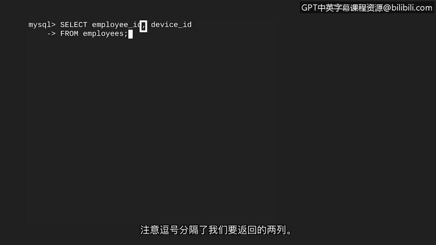
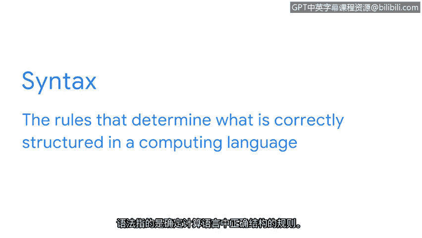
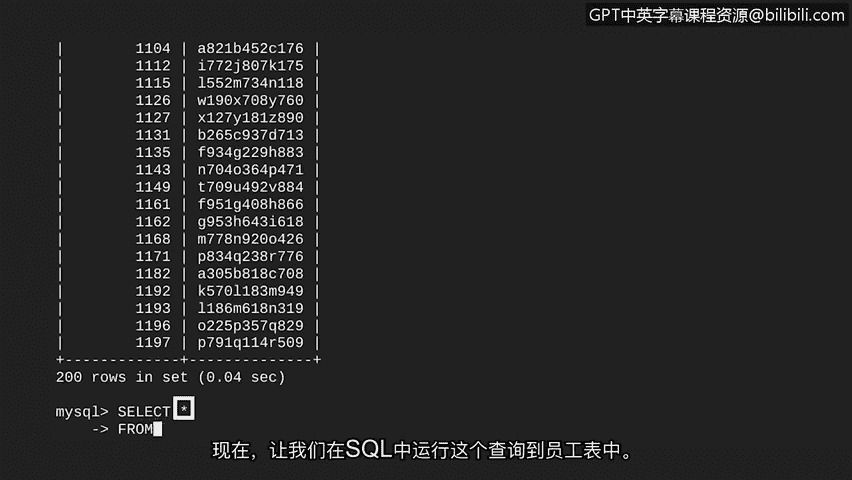

# 谷歌网络安全专业证书第四课：《工具之道：Linux与SQL》（中英字幕，前面分p中字，后面分p英字） - P35：34_基本查询.zh - GPT中英字幕课程资源 - BV1tm4y1x74y

In this video， we're going to be running our very first sequel query。😊。

This query will be based on a common work task that you might encounter as a security analyst。

We're going to determine which computer has been assigned to a certain employee。

 Let's say we have access to the employees table， and the employees table has five columns。

Two of them， employee I D and device I D contain the information that we need。

 We'll write a query to this table that returns only those two columns from the table。

The two SQL keywords we need for basic SQL queries are select and from select indicates which columns to return from indicates which table to query。

The use of these key words in SQL is very similar to how we would use these words in everyday language。

For example， we could ask a friend to select apples and bananas from the big box when going out to buy fruit。

This is already very similar to SQL。

So let's go ahead and useSe and from in SQL to return the information we need on employees and the computers they use。

We start off by typing in the SQL statement。After from。

 we've identified that the information will be pulled from the employees table。

And after selectEmploy ID and device ID， indicate the two columns we want to return from this table。

Notice how a comma separates the two columns that we want to return。

It's also worth mentioning a couple of key aspects related to the syntax of SQL here。

Syntax refers to the rules that determine what is correctly structured in a computing language。

In SQL。Keywords are not k sensitive， so you could also write， select and from， in lower case。

But replacing them in capital letters because it makes the query easier to understand。

 Another aspect of this syntax is that semicos are placed at the end of the statement。

And now we'll run the query by pressing enter。The output gives us the information we need to match employees to their computers。

We just ran our very first SQL query。Suppose they wanted to know what department the employee using the computer is from or their username or the office they work in。

To do that， we can use SQL to make another statement that prints out all of the columns from the table。

We can do this by placing an asterisk after select。 This is commonly referred to as select all。

Now， let's run this query to the employees table in SQL。And now we have the full table in the output。

You just made it through a basic query and SQL， congratulations！In the next video。

 we'll learn how to add filters to our queries， so I'll meet you there。

