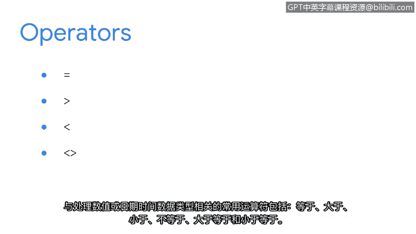
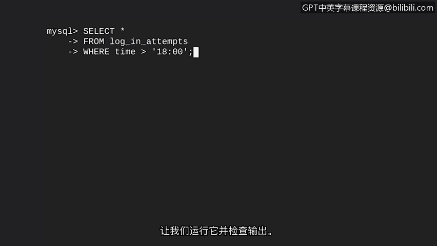
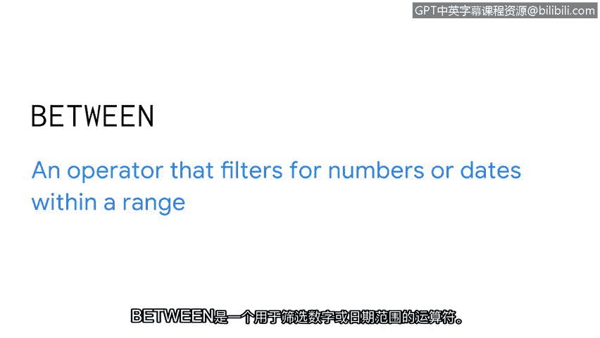
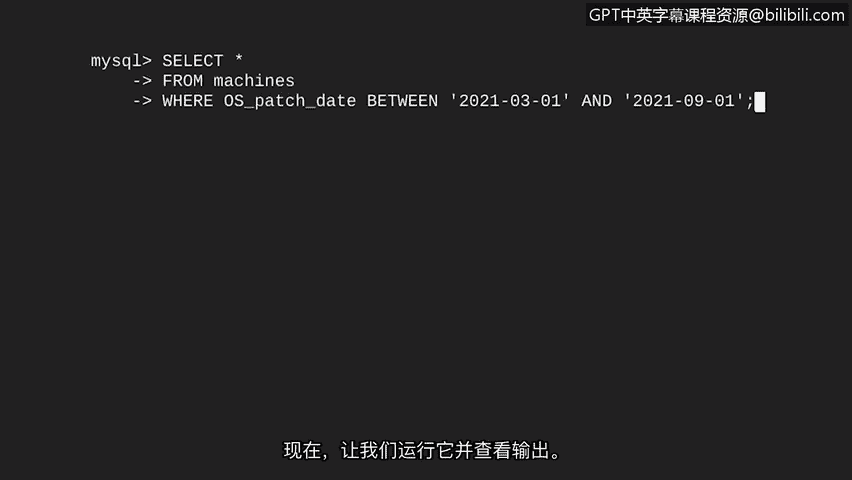

# 谷歌网络安全专业证书第四课：《工具之道：Linux与SQL》（中英字幕，前面分p中字，后面分p英字） - P37：36_日期和数字筛选.zh - GPT中英字幕课程资源 - BV1tm4y1x74y

In this video， we're going to continue using SQL queries and filters。

 but now we're going to apply them to new data types。First。

 let's explore the three common data types that you will find in databases， string， numeric。

 and day and time。String data is data consisting of an order sequence of characters。

These characters could be numbers， letters or symbols。For example。

 you will encounter string data in username， such as a username analyst 10 nuummeric data is data consisting of numbers。

Such as a count of login attempts。Unlike strings， mathematical operations can be used on numeric data。

 like multiplication or addition。Date and time data refers to data representing a date and or time。

Previously， we applied filters using string data， but now let's work with numeric and date and time data。

As a security analyst， you'll often need to query numbers and dates。 For example。

 we could filter patch dates to find machines that need an update。

Or we could filter login attempts to return only those made in a certain period of time。

We learned about operators in the last video， and we' are going to use them again for numbers and dates。

 Commonmon operators for working with numeric or date and time data types include equals greater than less than not equal to。

 greater than or equal to and less than or equal to。

 Let's say you want to find than logan attempts made after 6 PM。

 because this is past normal business hours。 You want to look for suspicious patterns。😊。

You can identify these attempts by using the greater than operator in your filter。

We'll start writing our query in SQL， we begin by indicating that we want to select all columns from the log underscore in underscore Ts table。

Then we'll add our filter with where。Our condition indicates that the value in the time column must be greater than or for dates and times later than 1800。

 which is how 6 PM is written in SQL。 Let's run this and examine the output。 Perfect。

 Now we have a list of login attempts made after 6 PM。😊。

We can also filter for numbers and dates by using the between operatorBetween is an operator that filters for numbers or dates within a range。

An example of this would be when looking for all patches installed within a certain range。

 Let's do this。Let's find all the patches installed between March 1st， 2021 and September 1st， 2021。

In our query， we start with selecting all records from the Ma table。

And we add the between operator in the where statement。Let's bring down the statement first。

 after where we indicate which column to filter in our case， O underscore patch underscore date。

Next comes our operator between。We then add the beginning of our range。

 type and then finish by adding the end of our range in a semicolon。 Now。

 let's run this and explore the output。 And now we have a list of all machines patch between those two dates。

Before we wrap up， an important thing to note is that when we filter for strings， dates， and times。

 we use quotation marks to specify what we're looking for。However， for numbers。

 we don't use quotation marks。With this new knowledge。

 you're now ready to work on all sorts of interesting filters for numbers and dates。😊。

In the next video， we'll be able to expand our filtering even further by using multiple conditions in one query。

