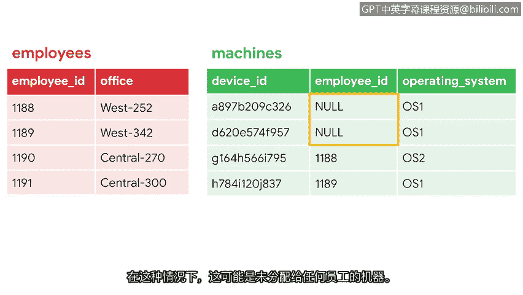
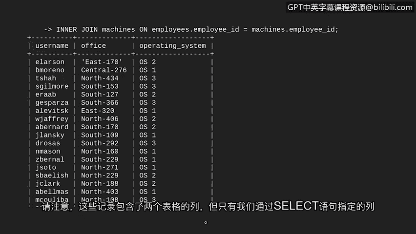

# 谷歌网络安全专业证书第四课：《工具之道：Linux与SQL》（中英字幕，前面分p中字，后面分p英字） - P39：38_在SQL中连接表.zh - GPT中英字幕课程资源 - BV1tm4y1x74y

You've already learned a lot about SQL queries and filters， nice work。

 The last concept we're introducing in this section is joining tables when querying a database。

This is helpful when you need information from two different tables in a database。

Let's say we have two tables， one that tells us about security vulnerabilities of different operating systems and one about different machines in our company。

 including their operating systems。Having the ability to combine them gives us a list of vulnerable machines。

 That's pretty cool， right？First， let's start talking about the syntax of joins Since we're working with two tables now。

 we need a way to tellSQL what table we're picking columns from。In our example database。

 we have an employee ID column in both the employeess table and the Ma table。

In SQL statements that contain two columns， SQL needs to know which column we're referring to。

The way to resolve this is by writing the name of the table first， then a period。

 and then the name of the column。So we would have employees followed by a period followed by the column name。

 This is the employee ID column for the employee table， Similarlyly。

 this is the employee ID column for the Ma table。Now that we understand this syntax。

 let's apply it to a join。Imagine that we want to get a deeper understanding of the employees accessing the machines in our company。

By joining the employees and the machines tables， we can do this。

We first need to identify the shared column that we'll use to connect the two tables。In this case。

 we'll use a primary key in one table to connect to another table where it's a foreign key。

The primary key of the employee's table is employee ID， which is a foreign key in the Ma table。

Employee ID is a primary key in the employee's table because it has a unique value for every row in the employees's table。

And no empty values。We don't have a guarantee that the employee ID column in the Ma table follows the same criteria since it's a foreign key and not a primary key。

Next， we'll use a type of join called an inner join。An inner join returns rows。

 matching on a specified column that exists in more than one table。

Tables usually contain many more rows， but to further explain what we mean by inner join。

 let's focus on just four rows from the employees table and four rows from the machines table。

We'll also look at just a few columns of each table for this example。

Let's say we choose employee ID in bold tables to perform an inner join。

Let's look at the two rows where there is a match。Both tables have 1188 and 1189 in their respective employee ID columns。

So they are considered a match。The result of the join is the two rows that have 1188 and 1189。

 and all columns from both tables。Before we move on to the queries。

 we have to talk about the null values in the tables。In SQL。

 null represents a missing value due to any reason。In this case。

 this might be machines that are not assigned to any employee。

Now let's bring this into SQL and do an inner join on the full tables。

Let's imagine we want to join these tables in order to get a list of users and their office location that also shows what operating system they use on their machines。

 Employ ID is a common column between these tables， and we can use this to join them。

But we won't need to show this column in the results。First。

 let's start with a basic query that indicates we want to select the username， office。

 and operating system columns。We want employees to be our first or left table。

 so we'll use that in our from statement。Now we write the part of the query that tells SQL to join the Ma table with the employeess table。

Let's break down this query。 In join tells SQL to perform the inner join。

 Then we name the second table we want to combine with the first。 This is called the right table。

In this case， we want to join machines with the employees table that was already identified after from。

Lastly， we tell SQL what column to base the join on in our case， we're using the employee ID column。

 since we're using two tables， we have to identify the table and follow that with the column name。

So we have employees employee ID and Ma do employee ID Let's review the output。Perfect。

We have now joined two tables， the results of our query displays the records that match on the employee ID column。

Notice that these records contain columns from both tables。

 but only the ones we indicated through our select statement。

There are other types of joins that don't require a match to join two tables。

 and we're going to discuss those in the next video， I'll meet you there。

