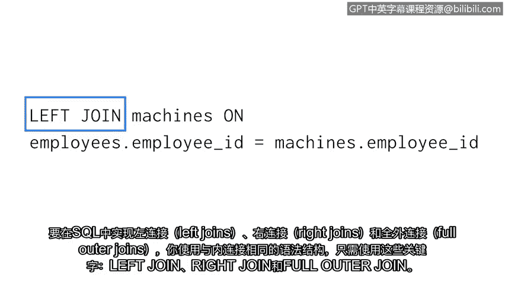

# 谷歌网络安全专业证书第四课：《工具之道：Linux与SQL》（中英字幕，前面分p中字，后面分p英字） - P40：39_连接表的类型.zh - GPT中英字幕课程资源 - BV1tm4y1x74y

Welcome back。 I hope you enjoyed working on inner joins In the previous video and exercises。

 we saw how inner joins can be useful by only returning records that share a value in specified columns。

 However， in some situations， we might need all of the entries from one or both of our tables。😊。

This is where we need to use outer joins。There are three types of outer joins， left join， right join。

 and full outer join， similar to inner joins， outer joins combine two tables together。However。

 they don't necessarily need to match between columns to return a row。

 which rows are returned depends on the type of join。

 Left join returns all of the records of the first table。

 but only returns rows of the second table that match on a specified column like we did in the previous video。

 Let's examine this type of join by looking at just four rows of two tables with a small number of columns。

Employs is the left table or the first table。 and the machines is the right table or the second table。

 Let's join on an employee I D。There is a matching value in this column for two or four records When we execute the join。

 SQL returns these rows with the matching value， all other rows from the left table and all columns from both tables。

Records from the employees table that didn't match。

 but were returned through the left join contained null values in columns that came from the machines table。

Next， let's talk about right joins。 right join returns all the records of the second table。

 but only returns rows from the first table that match on a specified column with the right join on the previous example。

 The full result returns matching rows from both。 All the rows from the second table and all the columns in both tables。

 for the values that don't exist in either table， we are left with a null value。Last。

 we'll discuss full outer joins。 full outer join returns all records from both tables。

 using our same example。 a full outer join returns all columns from all tables。

 If a row doesn't have a value for particular column， it returns null。 For example。

 the Mas table did not have any rows with employee Id 1190。

 So the values for that row in the columns that came from the machines table is null。

 to implement left joins， right joins and full outer joins in SQL。

 you use the same syntax structure as the inner join but use these keywords。 left join。

 right join and full outer join。

As a security analyst， you are not required to know all of these for memory。

 Once you understand the type of join you need， you can quickly search and find all the information you need to execute these queries。

With this information on joins， we've now covered some very important information you'll need as a security analyst using SQL。

 Thank you for joining me in this video。😊。