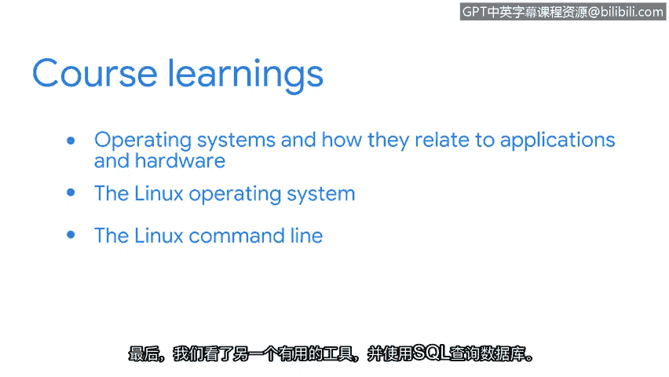

# 谷歌网络安全专业证书第四课：《工具之道：Linux与SQL》（中英字幕，前面分p中字，后面分p英字） - P42：41_课程总结.zh - GPT中英字幕课程资源 - BV1tm4y1x74y

You made it to the end of this course。 Congratulations。 You did it。😊。

I hope you are proud of all you learned。The focus of this course was computing basics understanding the basics of computing is a valuable skill as you transition into your career as a security analyst。

 Let's recap what you learned in this course。We first focus on operating systems and how they relate to applications and hardware。

Understanding how the system you're protecting works is essential for doing your job effectively。

That brings us to the Linux operating system。 When working in the security profession。

 familiarity with Linux is important。 We first discuss its architecture， and various distributions。

Then we use a Linux command line to carry out tasks you might encounter as a security analyst。

Finally， we looked at another useful tool and use SQL to query databases。

After this course， I hope you have a better understanding of how these foundations of computing support a security analyst in their daily work。

I also hope you continue your path with this program。

There are a lot of other useful and exciting topics ahead。 Once again， congratulations。😊。

You finished another courseBuilding skills is something you should be proud of。

 Keep it up as you progress through this program。

