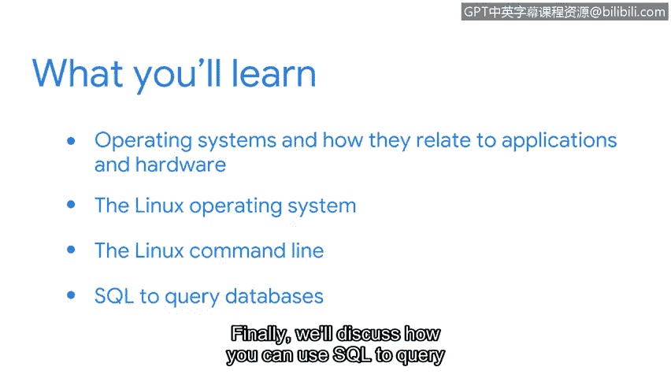

# 谷歌网络安全专业证书第四课：《工具之道：Linux与SQL》（中英字幕，前面分p中字，后面分p英字） - P43：0_01_introduction-to-course-4.en_subtitled - GPT中英字幕课程资源 - BV1tm4y1x74y

Hi， welcome to this course on computing basics for security。 My name is Kim。

 and I work as a technical program manager in security。 I grew up with computers and the internet。

 but didn't really consider security as a career opportunity until I saw how it was interwoven into technology。

😊，Before my first security job， I worked on a cloud application team and had to regularly interact with a security team。

It was my first experience working with security， but the idea of protecting information and working with others towards that goal was exciting to me。

As a result， I decided to work towards my CISSP， which led me to some new job opportunities at my company。

 and I was then able to move into security。At this point， if you've been following along。

 you've already explored a variety of concepts useful to the security field。

 including security domains and networking。 I'm excited to join you during the next part of the program。

 will take a slow so that you can understand these topics in practical ways。

 The focus of this course is computing basics。 When you understand how the machines in an organization system work。

 It helps you do your job as a security analyst more efficiently。

 Part of your job as a security analyst is to keep systems protected from possible attacks。

 You're one of the first levels of events in protecting an organization's data。

 To do this effectively。 It's helpful to understand how the system， your protecting works。😊。

In addition， you may need to investigate events to help correct errors in the system。

Being familiar with Linux operating system and its associated commands and also being able to interact with an organization's data through SQL will help you with that。

 In this course， you'll learn about operating systems and how they relate to applications in hardware。

 Next， you'll explore the Linux operating system in more detail。

 Then you'll use the Linux command line within a security context。 Finally。

 we'll discuss how you can use SQL to query databases while working as a security analyst。😊。

I'm excited to explore all of these topics with you。 Let's get started。😊。

