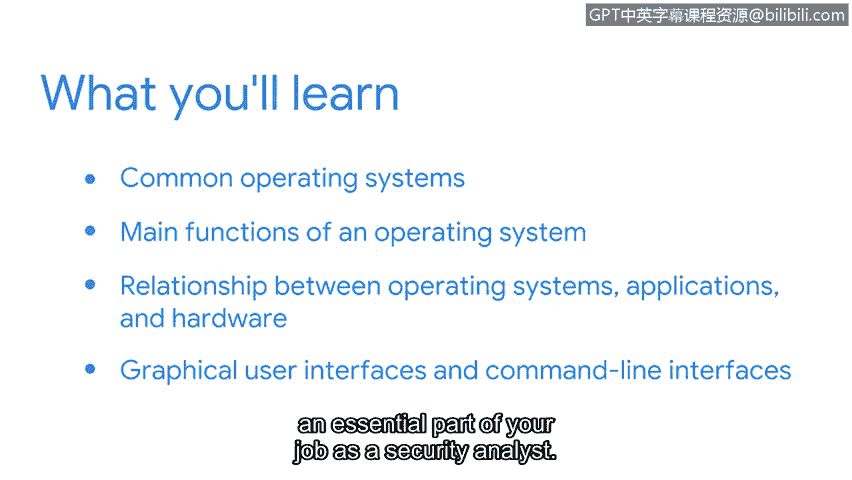

# 谷歌网络安全专业证书第四课：《工具之道：Linux与SQL》（中英字幕，前面分p中字，后面分p英字） - P44：1_01_welcome-to-week-1.en_subtitled - GPT中英字幕课程资源 - BV1tm4y1x74y

How many times a week do you use a computer for some of us， the answer might be a lot。

They're incredible machines that let us do everything from using specialized applications when completing a task at work。

 to sending emails to loved ones in a distant place。

Have you ever thought about how computers can do all of this？ Well。

 that's where operating systems come in。 In this section。

 we'll learn about common operating systems and we'll explore the main functions of an operating system。

 Then we'll learn the relationship between operating systems， applications and hardware。 Finally。

 we'll compare graphical user interfaces and command line interfaces。

 The command line interface will be an essential part of your job as a security analyst。😊。

Understanding operating systems is an important foundation for your career in security。

 There's so much to explore。 Let's begin。