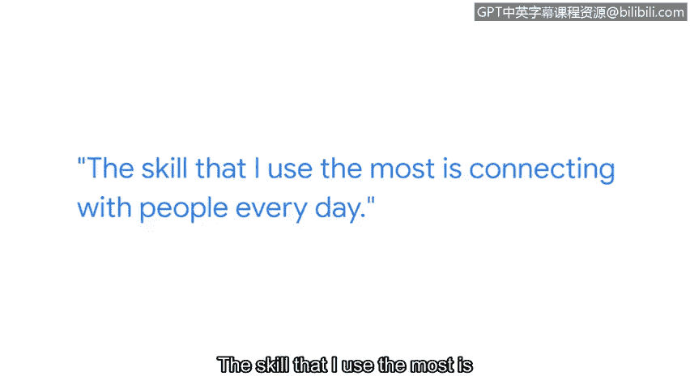

# 谷歌网络安全专业证书第四课：《工具之道：Linux与SQL》（中英字幕，前面分p中字，后面分p英字） - P45：2_02_kim-my-journey-into-computing.en_subtitled - GPT中英字幕课程资源 - BV1tm4y1x74y

Hi， I'm Kim。 I'm a technical program manager at Google I'm currently working in the security mergers and acquisitions team while I work with other companies that we purchase and I help them integrate into the Google environment I've held multiple roles before getting into cybersecurity and even technology I first started working as a restaurant worker and then I became an English tutor for international students at my local college after doing multiple internships and graduating from university I had my first opportunity to work in technology and that's where my interest in technology and eventually cybersecurity began I want to tell everyone with any type of background that you can get into cybersecurity if you're interested in protecting information if you're interested in protecting people in the future security is there for you there are so many different roles you can do and all of the skills that you have now and that you've gathered previously can be applicable within insecurity。

skillki that I use the most is connecting with people every day I can't get anything done unless I connect with them the right way so that's actually the biggest skill I lean on the most working in security。

 a piece of advice I would get for someone new starting in the cybersecurity field is to keep an open mind。

I started out with a degree in business， so I didn't even feel like I was technical enough to be where I am today。

And before that， all of my experiences were either restaurant work or marketing work or just something that felt like it was unrelated to technology。

But all of that helped me and motivated me to actually kind of get my feet more wet into technology and then eventually security and before I knew it。

 that self-doubt was really replaced with more of a support from my peers and respect from other people that I've worked with。

