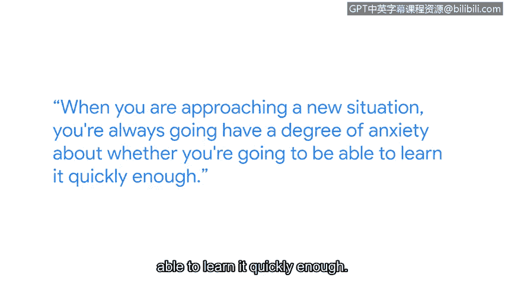

# 谷歌网络安全专业证书第四课：《工具之道：Linux与SQL》（中英字幕，前面分p中字，后面分p英字） - P54：11_03_phil-learn-and-grow-in-the-cybersecurity-field.en_subtitled - GPT中英字幕课程资源 - BV1tm4y1x74y

Hi I'm Phil I'm the chief information security officer for Google Cloud and a big part of that is of course cybersecurity So in cyber you've always got to learn you've always got to stay up to date for the simple reason that technology and business and the world of kind of digital lives is just always changing the online services that you used today probably very different even just from what they were 12 months ago in the mid-90s I worked on one of the world's first internet banking systems and essentially we were building and coding all of the security ourselves I remember working on know the first web browsers。

 the first web servers， the first implementations of encryption on the internet this was even before Google even existed and so this was at the very beginning of the internet and we were literally kind of assembling and building this and learning how to do it as we as we went along when you first getting into cybersecurity it's important to not get overwhelmed it's a very big space。

And all of us started off at where you are today and we had to learn into that at one point。

 I didn't know Linux。 I didn't know how to program。

 I didn't know various parts of other operating systems。

 and I had to learn step by step how all of that worked and gradually built up that knowledge over time and even now I still have to look things up occasionally because I don't keep everything in my head all at once and that's totally fine when you're approaching a new situation you're always gonna have a degree of anxiety about whether you're gonna be able to learn it quickly enough and generally with enough experience you gradually comfortable that you will but again。

 this is important to remember that you don't have to learn everything about everything all at once。

 most of the time you learn enough to be enough of value in the initial part of the process then you learn as you go start off by writing a few lines of simple code or looking at somebody else's code and trying to understand what it does and then change it a little bit and just incrementally work into this。

 build that foundation of。

owledge that gives you the ability to learn other things。

 And I think things will things will stem from that。

