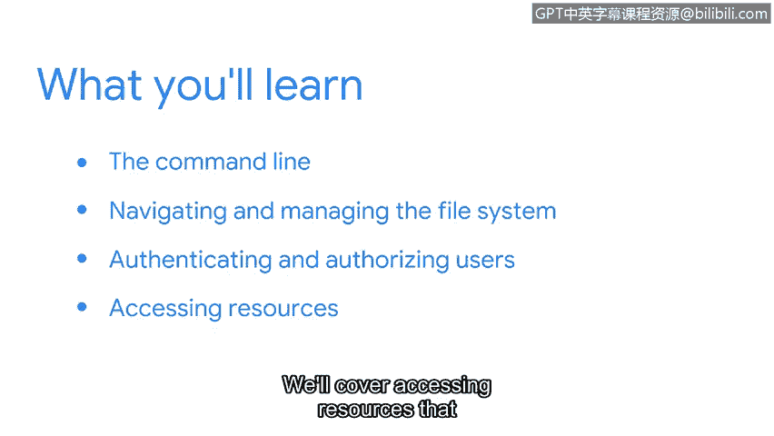

# 谷歌网络安全专业证书第四课：《工具之道：Linux与SQL》（中英字幕，前面分p中字，后面分p英字） - P61：18_01_welcome-to-week-3.en_subtitled - GPT中英字幕课程资源 - BV1tm4y1x74y

Learning to communicate in a new way can be exciting。

 Maybe you've learned a new language and can remember this feeling。

 Perhaps a lot of us share this excitement with young children as they are expanding their vocabulary。

😊，Others， including me， remember a sense of wonder when we first use a specialized language to communicate with a computer。

In this section， we'll continue to learn more about Linux and how to communicate with the OSs through its shell。

 You will utilize the command line to communicate with the OS。

You'll learn how to input commands in the shell and learn about some of the core Linux commands that you'll use as a security analyst。

Specifically， this includes navigating and managing the file system。

 You'll also focus on authenticating and authorizing users。

This means you'll be able to use a command line to add and delete users from the system and to control what they have access to。

Finally， there's always more to learn， so we'll cover accessing resources that support learning new Linux commands。

I remember when I first learned about the command line and was shocked at the capabilities it provided。

 I didn't need to click through multiple screens to get tasks done。

Although it took some practice and time to get used to。

 it has been one of the biggest tools at my disposal。After this section。

 you'll have a practical experience in an area important to the work of a security analyst using Linux commands。

