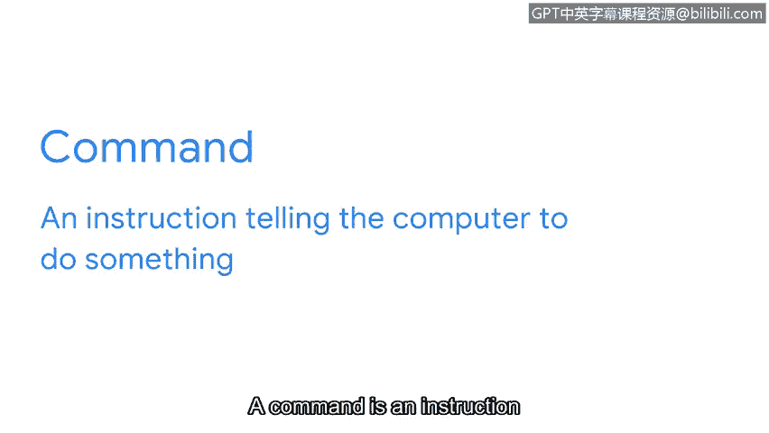
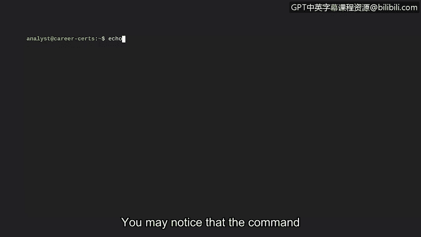
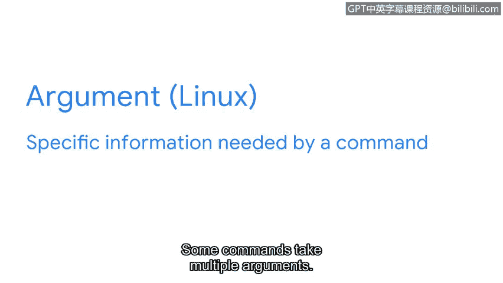
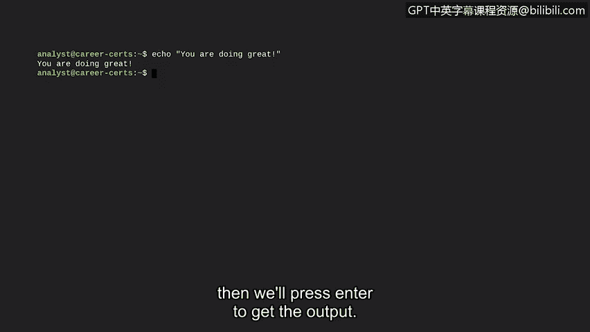

# 谷歌网络安全专业证书第四课：《工具之道：Linux与SQL》（中英字幕，前面分p中字，后面分p英字） - P62：19_02_linux-commands-via-the-bash-shell.en_subtitled - GPT中英字幕课程资源 - BV1tm4y1x74y

Welcome back Before we get into specific Linux commands。

 let's explore in more detail the basics of communicating with the OS through the shell。

Being able to utilize Linux commands is a foundational skill for all security professionals。

As a security analyst， you'll work with server logs and you'll need to know how to navigate。

 manage and analyze files remotely without a graphical user interface In addition。

 you'll need to know how to verify configured users during group access you'll also need to give authorization and set file permissions that means that developing skills with a command line is essential for your work as a security analyst。

When we learned about the Linux architecture， we learned that the shell is one of the main components of the operating system。

We also learn that there are different shells。In this section， we'll utilize the bashhe。

Bash is the default shell in most Linux distributions。For the most part。

 the key Linux commands that you'll be learning in this section are the same across shells now that you know what shell you'll be using。

 let's go into how to write in bash。As we discussed in the previous section。

 communicating with your OS is like a conversation。

You type in commands and the OS responds with an answer to your command。

A command is an instruction telling the computer to do something。 We'll try out a command in bash。

 Not a dollar sign before the cursor。 This is your prompt to enter a new command。

 Some commands might tell the computer to find something like a specific file。

Others might tell it to launch a program， or it might be to output a specific string of text。

In the last section， when we discuss input and output， we explored how the echo command did this。

 let's input the echo command again。

You may notice that the command we just input is not complete。

If we're going to use the Echo command to output a specific string of text。

 we need to specify what the string of text is。This is what arguments are for。

 An argument as specific information needed by a command。 Some commands take multiple arguments。

 So now let's complete the echo command with an argument。

We're learning some pretty technical stuff， so how about we output the words you are doing great。

We'll add this argument， and then we'll press enter to get the output。

In this example， our argument was a string of text。

 Arguments can provide other types of information as well。

One thing that is really important in Linux is that all commands and arguments are case sensitive。

This includes file and directory names， keep that in mind as you learn more about how to use Linux in your day to day task as a security analyst。

Okay， now that we've covered the basics of entering Linux commands and arguments through the ball。

 we're ready to learn some specific commands。 this is exciting， so let's get to our next video。

