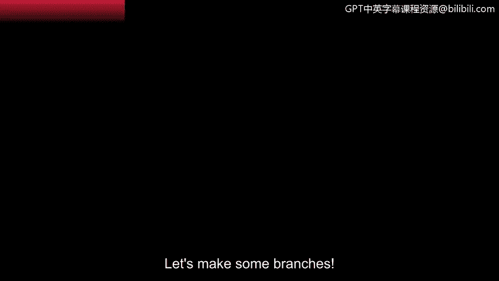
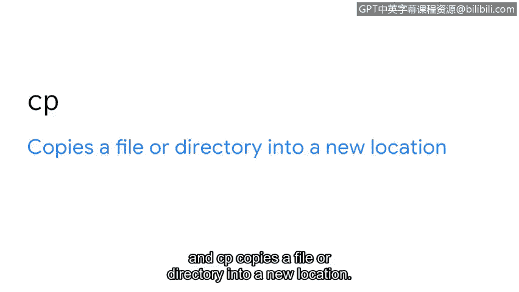
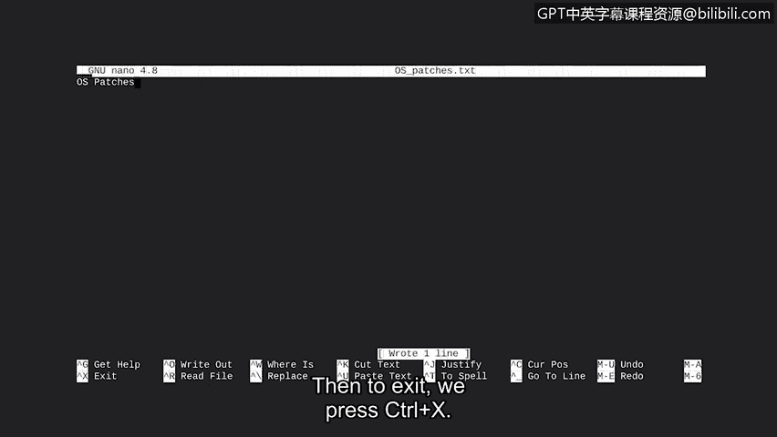

# 谷歌网络安全专业证书第四课：《工具之道：Linux与SQL》（中英字幕，前面分p中字，后面分p英字） - P65：22_03_create-and-modify-directories-and-files.en_subtitled - GPT中英字幕课程资源 - BV1tm4y1x74y

Let's make some branches。 What do I mean by that。While in a previous video。

 we discuss root directories and how other subdirecties branch off of the root directory。

 let's think again about the file directory system as a tree。

The subdirecties are the branches of the tree。 They are all connected from the same route。

But can grow to make a complex tree in this video， we'll create directories and files and learn how to modify them。

When it comes to working with data in security， organization is key。

If we know where information is located， it makes it easier to detect issues and keep information safe。

In a previous video， we've already discussed navigating between directories。

 but let's take a moment to examine directories more closely。

 It's possible you're familiar with the concept of folders for organizing information。And Linux。

 we have directories directories help organize files and subdirecties。For example。

 within a directory for reports， and analysts may need to create two subdirecties， one for drafts。

 and one for final reports。Now that we know why we need directories。

 let's take a look at some essential Linux commands for managing directories and files。First。

 let's take note of commands for creating and removing directories。

 the MKDIR command creates a new directory In contrast RMDIR removes or deletes a directory。

A helpful feature of this command is it's built in warning that lets you know a directory is not empty。

 This saves you from accidentally deleting files。Next。

 you'll use other commands for creating and removing files。 the Touch command creates a new file。

And then the RM command removes or deletes a file。And last。

 we have our commands for copying and moving files or directories。

The MV command moves a file or directory to a new location。

 and CP copies a file or directory into a new location。

Okay， now we're ready to try out these commands。First， let's use a PWD command。

And then let's display the names of the files and directories in the Ana directory with the LS command。

Imagine that we no longer need the old reports directory that appears among the file contents。

Let's take a look at how to remove it。We input the RMDIR command and follow it with the name of the directory we want to remove old reports。

We can use the Ls command to confirm that old report has been deleted and no longer appears among the contents。

 Now， let's make another change。We want a new directory for drafts of reports。

So we need to use a command MK D IR， and specify a name for this directory drafts if we input LS again。

 we'll notice the new directory drafts included among the contents of the analyst directory。

Let's change into this new directory by entering C drafts。If we run LS， it doesn't return any output。

 indicating that this directory is currently empty。But next， we'll add some files to it。

Let's say we want to draft new reports on recently installed email and OS patches。

To create these files， we input touch email underscorepates。tXT。

And then touch OS underscore patchches。txT。Running LS indicates that these files are now in the drafts directory。

What if we realize that we only need a new report on OS patches and we want to delete the email Pates report？

To do this， we input the RM command and specify the files to delete as。

Email underscore patches dot T， X， T running L S confirms that it's been deleted。 Now。

 let's focus on our commands for moving and copying。

 We realize that we have a file called email policy in the reports folder that is currently in draft format。

 So we want to move it into the newly created drafts folder to do this。

 We need to change into the directory that currently has that file。

Running LS in that directory indicates that it contains several files， including email_policy。txt。

Then to move that file， we'll enter the MV command followed by two arguments。

The first argument after MV identifies a file to be moved。

The second argument indicates where to move it。If we change directories into drafts and then display its contents。

 we'll notice that the email policy file has been moved to this directory。

We'll change back into reports。 Dising the file contents confirms that email underscore policy is no longer there。

Okay， one more thing vulnerabilities。txt is a file that we want to keep in the reports directory。

 but since it affects an upcoming project， we also want to copy it into the project directory。

Since we're already in the directory that has this file。

 we'll use a CP command to copy it into the projects directory。

Notice that the first argument indicates which file to copy and the second argument provides the path to the directory that it will be copied into Z。

When we press Enter， this copies the vulnerabilities file into the project's directory while also leaving the original within reports。

Isn't it cool what we can do with these commands Now let's focus on one more concept related to modifying files。

In addition to using commands， you can also use applications to help you edit files。

As a security analyst， file editors are often necessary for your daily tasks like writing or editing reports。

A popular file editor is Nano。 It's good for beginners。

You can access this tool through the nano command Let's get familiar with Naan together。

We'll add a title to our new draft report， OS_patches。txt。First。

 we changed into the directory containing that file。

Then we input nano followed by the name of the file we want to edit OS underscore patches。txc。

This brings up the nano file editor with that file open。For now。

 we'll just enter the title OS patches by typing this into the editor。

We need to save this before returning to the command line。

 and to do so we press C O and then enter to save it with the current file name。Then to exit。

 we press C X。

Great work。We've covered a lot of topics here from creating and removing directories and files to copying。

 removing them。 And just now， we've added editing files。

 You're well on your way to learning Linux commands。

