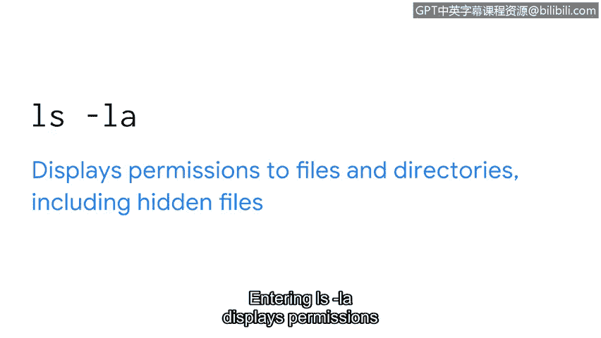
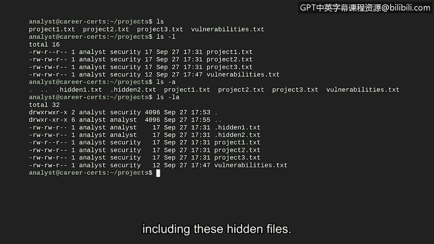

# 谷歌网络安全专业证书第四课：《工具之道：Linux与SQL》（中英字幕，前面分p中字，后面分p英字） - P66：23_01_file-permissions-and-ownership.en_subtitled - GPT中英字幕课程资源 - BV1tm4y1x74y

Hi there。 It's great to have you back。 Let's continue to learn more about how to work in Linux as a security analyst。

😊，In this video， we'll explore file and directory permissions。

We'll learn how Linux represents permissions and how you can check for the permissions associated with files and directories。

 Permissions are either type of access granted for a file or directory Permissions are related to authorization Authorization is the concept of granting access to specific resources in a system Authorization allows you to limit access to specified files or directories。

 A good rule to follow is that data access is on a need to know basis。

You could imagine the security risk it would impose if anyone could access or modify anything they wanted to on a system。

There are three types of permissions in Linux that an authorized user can have。

The first type of permission is read。On a file， read permissionmissions means content on the file can be read。

On a directory， this permission means you can read all files in that directory。

Next are right permissions right permissions on a file allow modifications of contents of the file on a directory right permissions indicate that new files can be created in that directory finally there are also execute permissions。

Execute permissions on files。Mean that the file can be executed if it's an executable file。

 Execcut permissions on directories allow users to enter into a directory and access its files。

 Permissions are granted for three different types of owners。 The first type is the user。

The user is the owner of the file。When you create a file， you become the owner of the file。

 but the ownership can be changed。Group is the next type。Every user is a part of a certain group。

A group consists of several users， and this is one way to manage a multi user environment。Finally。

 there is other。Other can be considered all other users on the system。

 basically anyone else with access to the system belongs to this group。In Linux。

 file permissions are represented with a 10 character string for a directory with full permissions for the user group。

 this string would be DRWX， RWX， RWX。Let's examine what this means more closely。

The first character indicates the file type， as shown in this example。

 D is used to indicate it is a directory。If this character contained a hyphen instead。

 it would be a regular file。The second， third， and fourth characters indicate the permissions for the user。

In this example， R indicates the user has read permissions W indicates the user has right permissions。

 and X indicates the user has execute permissions。If one of these permissions was missing。

 there would be a hyphen instead of the letter。In the same way， the fifth， sixth。

 and seventh characters indicate permissions for the next owner type group， as it shows here。

 the type group also has read， write， and execute permissions。

There are no hyphens to indicate that any of these permissions haven't been granted。Finally。

 the8 through 10th characters indicate permissions for the last owner type， other。

They also have read， writerite， and execute permissions in this example。

Ensuring files and directories are set with their appropriate access permissions is critical to protecting sensitive files and maintaining the overall security of a system。

For example， payroll departments handle sensitive information if someone outside of the payroll group could read this file。

 this will be a privacy concern。Another example is when the user， the group。

 and other can all write to a file。This type of file is considered a worldriable file。

Worldritable files can pose significant security risks。So how do we check permissions？First。

 we need to understand what options are， options modify the behavior of the command。

The options for our command can be a single letter or a full word。

Checking permissions involves adding options to the LS command。First。

 LSL displays permissions to files and directories。

You might also want to display hidden files and identify their permissions。Hidden files。

 which begin with a period before their name， don't normally appear when you use LS to display file contents。

Entering LS dash A displays hidden files。Then you can combine these few options to do both。

Entering L S， dash L。Displays permissions to files and directories， including hidden files。

Let's get into bash and try out these options。Right now， we're in the project subdirecty。First。

 let's use the LS command to display as contents。The output displays the files in this directory。

 but we don't know anything about their permissions。By using LSL instead。

 we get expanded information on these files， let's do this。

The file names are now on the right side of each row。

The first piece of information in each row shows the permissions in the format that we discussed earlier。

Since these are all files and not directories， notice how the first character is a hyphen。

Let's focus on one specific file， Project1。 Txt。The second through fourth characters of its permissions show us the user has both read and write permissions。

 but lacks execute permissions。In both the fifth through seventh characters and a through 10th characters。

 the sequence is R hyphen hyphen。This means group and other have only read privileges。

After the permissions， LSL first displays a username。Here that's us， analyst。

 next comes the group name， in our case， the security group。Now let's use LSA。

The output includes two more files。Hidden files with the names do hiddend1。txt and dot hiddend 2。txt。

Finally， we can also use LSL to show the permissions for all files， including these hidden files。

I thought that was pretty interesting。 Did you， You now know a little more about fall permissions and ownership。

This will be helpful when working in security because monitoring and setting correct permissions is essential for protecting information。

Take a small break and meet me in the next video。

