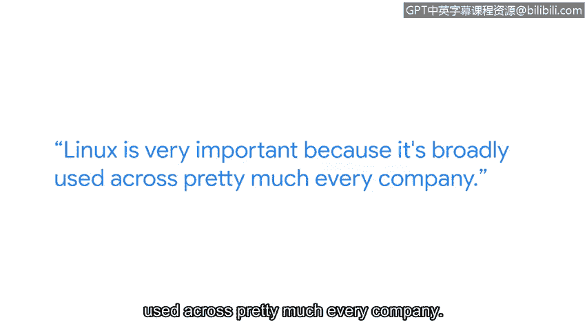

# 谷歌网络安全专业证书第四课：《工具之道：Linux与SQL》（中英字幕，前面分p中字，后面分p英字） - P69：26_01_damar-my-journey-into-linux-commands.en_subtitled - GPT中英字幕课程资源 - BV1tm4y1x74y

My names Demar， I'm a security engineer here at Google。

 I've always wanted to get into cybersecurity since I was a kid。

 a lot of the cartoons I watched they had like floppy disk or flash drives and they would put that in the computer and kind of like cause havoc。

So I always thought that was really cool。 I've had quite a bit of jobs before coming to Google。

 I've originally started out making smoothies ofjama juice。

 I got my first like IT technological kind of job at geekqua and then eventually came here and became a security engineer。

 My advice to people trying to get into cybersecurity is it may be a lot easier than you think。😊。

ItIt definitely was a lot easier than I thought something that I learned jumping in myself is that you're not going to be able to learn everything all at once and you're not going to need to know everything all at once。

 Linux is very important because it's broadly used across pretty much every company。

 You may use Linux to curate logs。 It's a very common practice。

 you may also use Linux to shut up bash jobs that will help with routine task within Linux。

 I first got interested in learning Linux from the Jurassic park movie。

 There's a scene in the movie where they need to reactivate the electrical doors and they have to use a Uni operating system to do so。

 Later on， I learn what Uni was and how Linux came from it。

 and it inspired me to learn more about Linux。 The best advice I can give someone that's trying to learn Linux and Linux commands is don't get discouraged by any small hiccups that come up。

 Just keep with it。😊。

Stick with it， think of it as when you first learned to swim， right。

 you probably weren't that great at it。 It was frustrating and you were probably a little scared。

 but you stuck with it。 and I hope that you're able to swim now。

There are a plethora of support resources when learning Linux one good example is the discussion forum in the certificate course。

 Another avenue of support for learninging Linux is just googling answers using stack overflow。

 maybe even making a Reddit post I love working a cybersecurity It's pretty satisfying to know that me and my team and then like all of the other security teams here at Google are helping protect people online from things they may not even know about。

