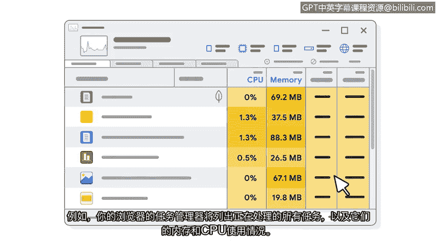

# 谷歌网络安全专业证书第四课：《工具之道：Linux与SQL》（中英字幕，前面分p中字，后面分p英字） - P6：5_通过操作系统进行资源分配.zh - GPT中英字幕课程资源 - BV1tm4y1x74y

Now we're ready to discuss a different aspect of your operating system。

 not only does the OS interact with other parts of your computer。

 but is also responsible for managing the resources of the system。

This is a big task that requires a lot of balance to make sure all the resources of the computer are used efficiently。

Think of this like the concept of energy。A person needs energy to complete different tasks。

 Some tasks need more energy， while others require less。 For example。

 going for Iran requires more energy than watching TV。

A computers OS also needs to make sure that it has enough energy to function correctly for certain tasks。

Rriuning an antivirus scan on your computer will use more energy than using the calculator application。

Imagine your computer is an orchestra。 Many different instruments like violins。

 Drs and trumpets are all part of the orchestra。 An orchestra also has a conductor to direct the flow of the music In a computer。

 the O is a conductor。 The O handles resource and memory management to ensure the limited capacity of the computer system is used where it's needed most。

A variety of programs， tasks， and processes are constantly competing for the resources of the Central Proing Unit or CPUU。

They all have their own reasons why they need memory， storage， and input output bandwidth。

The OS is responsible for ensuring that each program is allocating and deallocating resources。

All this occurs in your computer at the same time so that your system functions efficiently。

 Much of this is hidden from you as a user。For example。

 your browser's task manager will list all of the tasks that are being processed along with their memory and CPU usage。

As an analyst， it's helpful to know where systemss resources are used。

Understanding usage of resources can help you respond to an incident and troubleshoot applications in the system。

For example， if a computer is running slowly and analyst might discover its allocating resources to malware。

 a basic understanding of how operating systems work will help you better understand the security skills you will learn later in this program。

